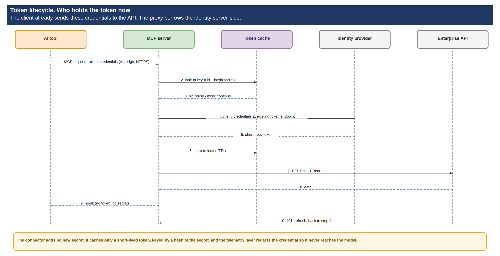
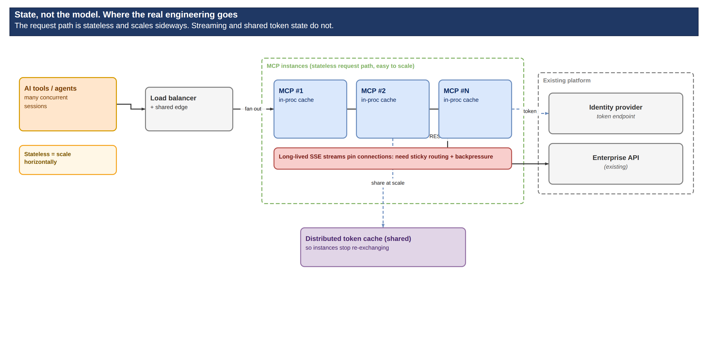

# The Model Is the Easy Part

*I put an MCP server in front of a production API. The hard parts were tokens and state, not the model.*

A request landed on my desk that sounded like the future: let customers point their AI tools at our data. Claude, Copilot, whatever agent they run. Ask a question in plain language, get an answer back from the platform.

Everyone in the room pictured the model. I did too, for about a minute. Then the only question that actually mattered showed up, and it had nothing to do with AI: how does the robot log in?

I want to be honest about the pull I felt. New shiny problem, new shiny solution. Part of me wanted to design something novel for it, a bespoke way for agents to authenticate, because novel is fun and novel gets noticed. What follows is one connector's story, not a security standard.

The thing I actually shipped is almost aggressively boring. And that was the point.

## A connector that adds nothing new

The connector is an *MCP server*, an implementation of the [Model Context Protocol](https://modelcontextprotocol.io/), sitting in front of an existing REST API. It translates "answer questions about my data" into calls the API already knows how to serve. No new data path. No new store. It reads, it does not write.

If that shape sounds familiar, it should. It is an anti-corruption layer, the [same pattern I keep prescribing to human departments](/blog/the-anti-corruption-layer-is-for-people-too/), pointed at AI clients instead. The core API keeps its model. The connector absorbs the foreign one. The AI gets a clean, narrow surface and never touches the inside.

Here is the rule I set on day one: **the connector introduces no new way to trust anyone.** The customer already holds credentials for the API. They already exchange those credentials for a token at an endpoint that already exists. The connector does exactly that, on their behalf, and nothing else. No new grant type, no new token broker, no new key store to guard.

## Who holds the token now

There is one thing that quietly changes, and you have to own it.

Today the customer's own client holds the token. With a hosted connector in the middle, my process holds it. It reads the credentials off the request, exchanges them for a short-lived token, caches that token, calls the API, and refreshes when the API says the token expired.

So I treated the cache like it was radioactive. The key is the client id plus a hash of the secret, never the secret itself. The token lives for minutes. And the secret never enters the model's context, not once, because the one thing worse than leaking a credential is leaking it into a transcript that gets replayed to a language model ;) The telemetry layer redacts it too.

None of that is AI work. It is the plumbing you would build for any proxy that borrows someone's identity. The AI just made the stakes legible.

## The boring option won on purpose

There were three real ways to do the auth. Machine login, reusing the existing credential exchange. An issued key with a token broker in front. A full browser login with per-user consent. Each is defensible. Each also drags an architecture behind it, and [decisions carry an architecture whether you draw it or not](/blog/decisions-have-an-architecture-too/).

Not everyone in the room wanted boring. Novel had fans, and I didn't argue with them. I asked [the same three questions](/blog/questions-are-an-architects-sharpest-tool/) of each option instead: who rotates this credential, who answers when it leaks, which team owns the new moving part? For the machine login, every answer was "the people who already do". For the other two, every answer was a new promise someone would have to keep. The room did not pick boring because I pushed it. Boring is what survived the questions.

I chose the machine login, the one that invents the least. When security reviewed it, the finding was the sentence I had been aiming at the whole time: **no new risk compared to using the API directly.** That is not a compliment to my cleverness. It is the absence of my cleverness, on purpose. **The interesting part of an AI feature is usually the least AI part of it.**

## The hard part was never the AI

Where did the time go? State.

The model is a stateless call and a stream of tokens back. Fine. But those streams are long-lived connections, and long-lived connections don't love being spread across a fleet of identical instances behind a load balancer. The in-process token cache that is so tidy on one node becomes a coordination problem on 20. Sticky sessions, a shared cache, backpressure on open streams: that is the actual engineering, and **none of it has "AI" in the name.**

My resolution followed the same rule as the auth: invent the least. Streams pin to the node that opened them, plain session affinity at the gateway we already run. Tokens stay in each node's own memory, and a cache miss costs one extra exchange against an endpoint that was built for that traffic. I looked hard at a shared token store and said no. New infrastructure, secrets at rest in one more place, one more thing to guard and to explain in a review. Twenty small caches that are each allowed to be wrong beat one big cache that has to be right.

Add the unglamorous edge, reused wholesale instead of rebuilt: the same gateway, the same web firewall, the same per-tenant rate limiting, the same audit trail the rest of the platform already trusts. The connector earns its keep by being **indistinguishable from a normal service**, right up until you ask it a question in English.

## Try this

Next time an AI capability lands on your roadmap, write down the auth and the state design before you write a single prompt. If the interesting decisions are all about identity, custody, and connection lifecycle, and the model is a plain call at the end, you're probably building it right.

So: what did you have to add to let the AI in? If the answer is a new way to trust something, look at that part again before the demo rather than after, because a working demo is the hardest argument to reverse in any organization I have worked in, and nobody wants to relitigate token custody once 40 people have watched the thing answer a question in English.

---

**Updated:** 2026-08-01 16:10

**Scores:** tension=7 originality=7 personal=8 contrarian=8 substance=9 punch=9 trend=9
**Scored:** 2026-07-27 rubric=v1 model=claude-opus-5

**Tags:** Software Architecture, Artificial Intelligence, API Security, Domain-Driven Design, Decision Making
