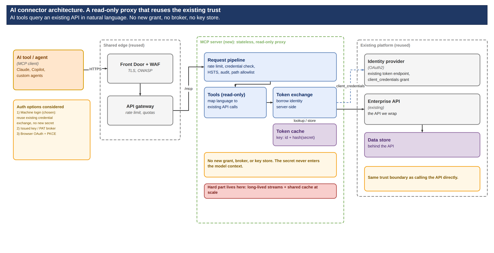

# The Model Is the Easy Part

*I put an MCP server in front of a production API. The hard parts were tokens and state, not the model.*

A request came to me that sounded like the future: let customers connect their AI tools to our data. Claude, Copilot, whatever agent they run. They ask a question in plain language and get an answer back from the platform.

Everyone in the room was thinking about the model. I was too, for about a minute. Then came the only question that was important at that moment, and it had nothing to do with AI: how does the robot log in?

I will be honest about the temptation. A new shiny problem asks for a new shiny solution. Part of me wanted to design something special for it, a dedicated way for agents to authenticate, because new things are fun and new things get noticed.

What I shipped in the end is very boring, and this was exactly the intention.

## A connector that adds nothing new

The connector is an *MCP server*, an implementation of the [Model Context Protocol](https://modelcontextprotocol.io/), sitting in front of an existing REST API. It translates "answer questions about my data" into calls the API already serves, and that is all it does. There is no new data path and no new store. The connector only reads.

Maybe you recognise the pattern. It is an anti-corruption layer, the [same pattern I keep recommending between human departments](/blog/the-anti-corruption-layer-is-for-people-too/), this time facing AI clients. The core API keeps its model and the connector takes the foreign one on itself. The AI gets a clean, narrow surface and never touches the inside.

The rule I set on day one was: **the connector introduces no new way to trust anyone.** The customer already holds credentials for the API and already exchanges them for a token at an endpoint that exists. Somebody already described how the rotation works, and the on-call rota already knows whose phone rings. The connector does exactly the same on the customer's behalf. So we need no new grant type, no token broker and no additional key store to guard.

## Who holds the token now

One thing does change, and you have to take responsibility for it.

Today the customer's own client holds the token. With a hosted connector in the middle, my process holds it. It reads the credentials off the request, exchanges them for a short-lived token, hands that token to the caller for one hop, and forgets it again before the next request arrives. It caches that token and calls the API. When the API says the token expired, it refreshes.

So I treated the cache as something dangerous. The key is the client id plus a hash of the secret, never the secret itself, and the token lives for minutes. The secret also never enters the model's context, and the telemetry layer redacts it too. The one thing worse than leaking a credential is leaking it into a transcript that is later replayed to a language model ;)

None of that is AI work. You would build the same plumbing for any proxy that borrows someone's identity. The AI part only made it visible how much depends on this plumbing.

## The boring option won on purpose

There were three realistic ways to do the auth: a machine login that reuses the existing credential exchange, an issued key with a token broker in front, or a full browser login with per-user consent. Each of them can be defended. Each also brings its own architecture with it, because [decisions carry an architecture whether you draw it or not](/blog/decisions-have-an-architecture-too/).

Not everyone in the room wanted the boring one. The new options had their fans and I didn't argue with them. Instead I asked [the same three questions](/blog/questions-are-an-architects-sharpest-tool/) about each option: who rotates this credential, who answers when it leaks, and which team owns the new moving part? For the machine login every answer was "the people who already do it". For the other two every answer was a new promise that somebody would have to keep. So I did not have to push the boring option. After those questions it was the only one left on the table.

I chose the machine login, the option that invents the least. When security reviewed it, the finding was the sentence I had been aiming at from the beginning: **no new risk compared to using the API directly.** It says nothing about me being clever, and that is fine, because the whole idea was to not be clever here. In my experience the interesting part of an AI feature is usually the part with the least AI in it.

## The hard part was never the AI

So where did the time go? Into state.

The model itself is a stateless call and a stream of tokens back, which is fine. But those streams are long-lived connections, and long-lived connections are hard to spread across a fleet of identical instances behind a load balancer. The in-process token cache that looks so simple on one node becomes a coordination problem on 20. You start to talk about sticky sessions, a shared cache and backpressure on open streams. That is where the engineering is, and none of it has "AI" in the name.

My solution followed the same rule as the auth: invent the least. Streams stay on the node that opened them, with plain session affinity at the gateway we already run. Tokens stay in each node's own memory, and a cache miss costs one extra exchange against an endpoint that was built for that traffic. I considered a shared token store seriously and decided against it. It means new infrastructure, secrets at rest in one more place, and one more thing to guard and to explain in a review. I prefer twenty small caches that are each allowed to be wrong over one big cache that has to be right.

The edge is also reused completely and not rebuilt: the gateway, the web firewall, the per-tenant rate limiting, the audit trail the rest of the platform already trusts, and the dashboards somebody already looks at on a Monday morning. For operations the connector is **indistinguishable from a normal service**, until the moment you ask it a question in English.

## Try this

Next time an AI capability appears on your roadmap, write down the auth and the state design before you write a single prompt. If every interesting decision is about identity, custody and connection lifecycle, and the model is a plain call at the end, you are probably building it right.

And ask yourself what you had to add to let the AI in. If the answer is a new way to trust something, look at that part again before the demo and not after it. In every organization I have worked in, a working demo was the hardest argument to reverse. Nobody wants to discuss token custody again once 40 people have watched the thing answer a question in English.

---

**Updated:** 2026-11-14 12:34

**Scores:** tension=7 originality=7 personal=8 contrarian=8 substance=9 punch=9 trend=9
**Scored:** 2026-07-27 rubric=v1 model=claude-opus-5

**Tags:** Software Architecture, Artificial Intelligence, API Security, Domain-Driven Design, Decision Making
