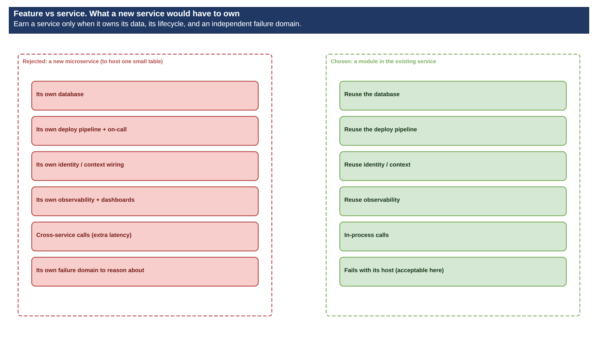
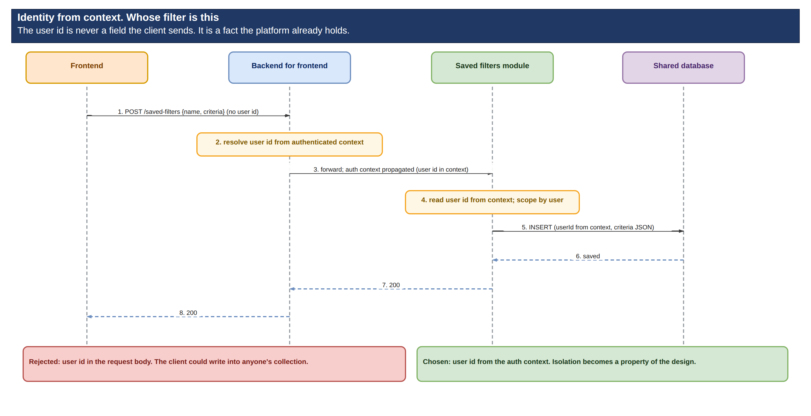
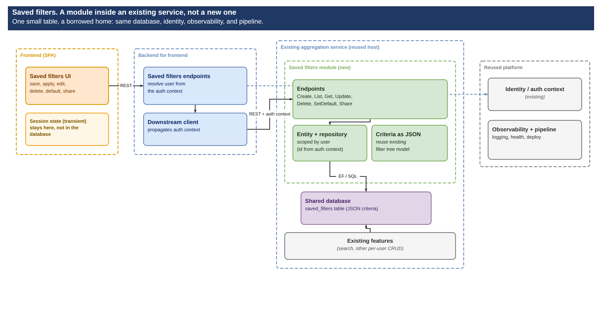

# A Feature Is Not a Service

*The ticket said "saved filters". The real decisions were which service, whose identity, and how little to invent.*

The ticket was small enough to fit in one sentence. Let users save a set of filters, give it a name, and load it again later. A default view on login. Maybe share one with a colleague.

The first design instinct in the room was a new service. It had a name before it had a schema: its own repository, its own database, its own deployment. That is the reflex a lot of us share, and I understand it. A new capability feels like it deserves a new home. It rarely does.

I have built that unnecessary home before, so I know its smell.

What shipped was one table in a service that already existed, and three decisions that had nothing to do with filters.

## The service that shouldn't exist

Saved filters is, underneath the product language, a small piece of per-user CRUD. Create, list, edit, delete, one of them marked as default. That is not a system. That is a table and a handful of endpoints.

I didn't fight the new service in the meeting. I asked it the three questions I ask every candidate service, out loud, one at a time. What data would it own that nobody else already owns? What lifecycle does it have that its host would not give it? What can fail inside it that should not take the feature down anyway? The answers came back borrowed, none, and nothing. The proposal did not need an opponent after that. It needed a smaller ticket.

So it went inside the service that already aggregates the data the filters run against. Same database, same identity plumbing, same logging and health checks and deploy pipeline. A new service inherits none of that. It owes you all of it. **A feature earns a new service when it has its own data, its own lifecycle, and its own reason to fail alone.** Saved filters has none of those. It borrows all three.

This is the quiet side of the job, and [these are exactly the decisions that never reach a slide](/blog/decisions-have-an-architecture-too/). The service you chose not to create leaves no artifact behind. Nobody congratulates you for the microservice that isn't there.

## Whose filter is this

The sharpest decision was the smallest field: the user id.

The naive version takes it from the request. The client says "save this filter for user 4213," and the server obliges. It works in the demo. It is also a door: anyone who can call the endpoint can write into anyone else's collection by changing a number.

So **the user id is never in the request body.** It comes from the authenticated context the gateway already forwards downstream, the same context every other call in the platform is scoped by. The client cannot name a user. It can only be one. **The safest user id is the one the client never gets to type.** Isolation stops being a check I have to remember to write, and becomes a property of where the value comes from.

## Copy the nearest working thing

There is always a temptation to design the storage from scratch. Saved filters can hold nested AND/OR logic, so surely it needs a clever relational schema.

It did not. The platform already had a filter model, the exact tree the search feature passes around every day. A saved filter is just that tree, parked in a JSON column, next to the user who owns it. I found the closest existing feature that already did per-user CRUD with that model, and I copied its shape almost line for line. **Reuse over invention is not laziness.** It is the difference between a feature that behaves like the rest of the system and one that surprises whoever reads it next. It is also [the rule that kept an MCP connector boring](/blog/the-model-is-the-easy-part/) last week: reuse the trust you already have, invent nothing you will have to guard.

This is the [mathematician's move](/blog/mathematicians-vs-lawyers/): don't add a new concept when an attribute of an existing one will do. The people who wanted a rich new "saved filter" model were about to breed a small universe of edge cases that a JSON blob of an existing tree simply never has.

## Draw the line at durability

One more decision, easy to get wrong in the other direction: how much to persist.

Part of the ticket was really about session state. Keep my filters while I click from the list into a detail and back. That is not a database problem. That is the frontend holding its own state for the length of a visit. I have cleaned up after the other choice before: a store of "recent selections" that outlived its feature by years, rows nobody dared delete because nobody could say who still read them, which is the precise mechanism by which a small convenience becomes a permanent liability that nobody has the authority to remove. The backend stores the thing you named and want back next week. It doesn't store the thing you'll forget by lunch. Ghost tables start here.

## Try this

Look at the last feature you gave its own service. Strip the product language off it and ask three questions. Does it own data nobody else owns? Does it have a lifecycle of its own? Can it fail by itself without taking a real capability down with it?

If it cannot answer yes three times, it was never a service. It was a table wearing a lanyard. What would you fold back in?

---

**Updated:** 2026-08-01 16:10

**Scores:** tension=6 originality=5 personal=8 contrarian=5 substance=8 punch=8 trend=3
**Scored:** 2026-07-27 rubric=v1 model=claude-opus-5

**Publish:** 2026-07-27 13:13

**Tags:** Software Architecture, Domain-Driven Design, Decision Making, Systems Thinking, API Security
