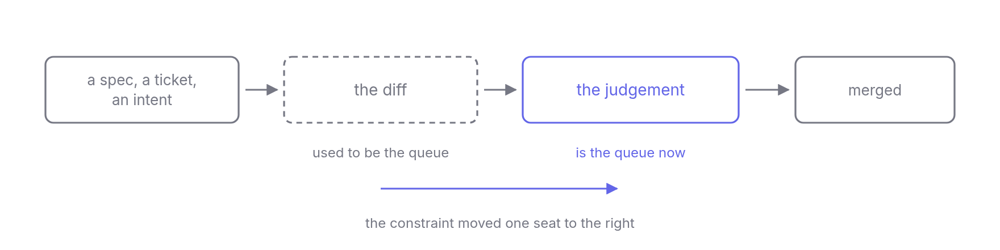
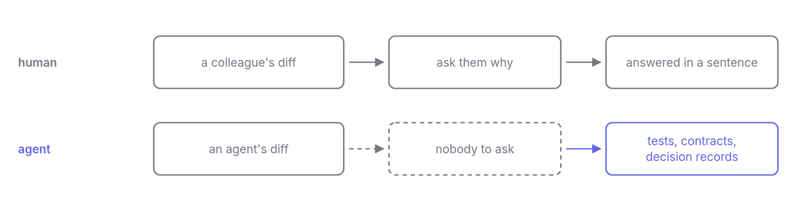

# The Bottleneck Moved

*AI made writing code cheap. Our squad reports show where the queue went next: to the people who have to read it.*

I read squad reports for a living now. Fifteen of them, every month, from teams at different stages of an AI transformation that covers several hundred developers. Sometime this spring, the complaints changed shape.

For years the standing blocker was production. Not enough hands, not enough hours, the backlog only grows. This spring the sentence flipped. We are not blocked on writing the code, the reports said. We are blocked on getting it absorbed: reviewed, understood, trusted, merged.

These are notes from one organization, mine, with every bias that implies. But I have checked the pattern against enough teams now to stop filing it as an anecdote.

The queue did not shrink. It moved one seat to the right.

## Typing was never the unit of work

We staffed for production because production was visible. Headcount plans, story points, velocity charts: every dial on the dashboard points at how much gets written. Then the cost of producing a diff fell through the floor, and the dials kept pointing at the part that got cheap.

What did not get cheap is deciding whether the diff is right.

A senior engineer who used to review four colleagues now reviews four colleagues plus everything their agents produce. The reports describe the same scene in different words. Pull requests aging in queues. Reviewers rubber-stamping out of exhaustion. Or the opposite: one reviewer becomes the only honest gate, and everything slows to their reading speed.

**Nobody is blocked on writing anymore. Everybody is blocked on believing.**

I met this bottleneck alone before I met it at scale. Running [a company of one staffed by agents](/blog/a-company-of-one-staffed-by-agents/), I am my own review queue, and my throughput is capped by what I can verify, not by what the agents can generate. The organizational version is the same shape with worse feedback loops.

## A diff with nobody behind it

There is a reason review did not get cheaper alongside writing, and it took me months to name it.

Reviewing a colleague's change was never a purely technical act. It was a conversation with a counterparty. You read the diff, a question formed, and you walked over and asked it. Why this shape? What did you try first? The answer usually came back in one sentence, because the person who made the decision was still holding it in their head.

An agent's diff has no such person. The intent behind it lived in a prompt, in a context window, in a session that has since closed. You cannot ask the author what they were thinking. There was no thinking of the kind you mean, and the human who ran the prompt is often meeting the result at the same moment you are.

I have started calling these authorless diffs. The code is here, the counterparty is not, and every question you would have walked over to ask now needs somewhere else to go.

**So the question has to be answerable by the system itself, or it does not get answered.**

## Reviewability is a system property

Which is the part I can act on as an architect. How hard a change is to review is not a fact about the reviewer. It is a fact about the system.

You can design a system to be easy to review the same way you design a database to be easy to query. Tests that state intent, so a green suite means something specific. Contracts at the seams, so a change's blast radius is visible from its diff. Small modules with real boundaries, so nobody has to page the whole system into their head. Decision records that say which paths were rejected and why. Context files that tell an agent, or a new colleague, where the bodies are buried.

None of this advice is new. **What is new is the price of ignoring it, because now the unreviewable system is the slow system.**

Indexes made queries cheap long after disks made storage cheap. Reviewability is the index we now owe our own codebases.

## What "done" has to mean now

The definition of done in most teams was written when writing was the scarce step. Code complete, tests pass, merged. Verification was assumed to be somebody's background job.

That assumption is now the whole game. If producing a change costs an afternoon and trusting it costs three days, then the three days are the work. The definition of done, the staffing plan and the promotion criteria should all say so.

**A senior engineer whose main output is judgment about other people's diffs is not doing less engineering.** They are doing the engineering that is left.

The dashboards will resist this, because dashboards count what is easy to count, and reading has always been [the thing we measure worst](/blog/probabilistic-metrics/).

## What I watch now

I still read fifteen reports a month. What changed is the line I look for first.

It used to be the delivery numbers. Now it is a sentence buried in the middle of the wins section, the one admitting that a squad shipped something and nobody could tell whether it was right for a week. That sentence is not a complaint about tooling. It is a system telling you where its constraint sits.

The dashboards above those reports are still counting output, because output is what dashboards were built to count, and I do not expect that to change quickly. But the reports underneath them stopped talking about production some time this spring, and they have not gone back.

The queue did not shrink. It moved one seat to the right, and it is quieter over there, which is why it took a season to notice. If your dashboards are green while your pull requests age, it has moved in your organization too. The authorless diffs are already arriving. The seat they queue for is not on your headcount plan.

---

**Scores:** tension=8 originality=7 personal=7 contrarian=7 substance=8 punch=8 trend=9
**Scored:** 2026-07-27 rubric=v1 model=claude-fable-5

**Publish:** 2026-08-03 09:00

**Tags:** Artificial Intelligence, AI Transformation, Engineering Leadership, Organizational Design, Software Architecture
