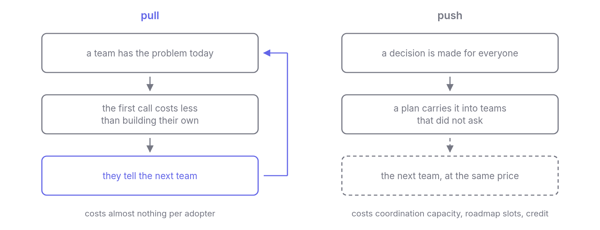
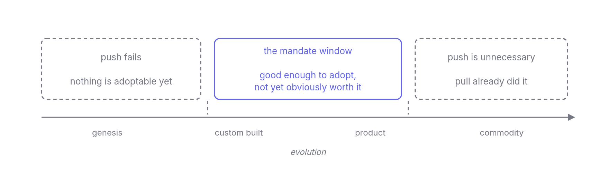

# Adoption Is the Deliverable

*The ugliest service in production beats the most elegant one nobody calls. So where exactly does an architect's job end?*

Two services on one platform solved almost the same problem. One of them was built properly: clean boundaries, a published contract, a model you could read cold and still follow. The other one was a lump. Vague naming, a schema that had recorded somebody's Tuesday, and no versioning story worth the name.

Four teams integrated with the lump.

For a while I explained to myself why this was the organization's failure. It was not. I have stopped arguing with the result. The lump sat closer to what people needed on the day they needed it, and no design review was going to close that gap.

One platform, one architect watching it. Notes, not data.

## The responsibility line is drawn in the wrong place

Ask most architects where their job ends and you get a version of the same answer. At the design. Or at the first working version. Adoption after that belongs to delivery, or to product, or to whoever runs the platform. It is a tidy answer. I gave it for years.

That line is comfortable, and it produces exactly the thing I described above: a correct system that nobody depends on. It is the mirror image of the orphaned aggregate I wrote about in [Nobody Owns the Sum](/blog/nobody-owns-the-sum/). There, a whole that nobody owned. Here, a part that nobody wanted.

So this is the measure I use now. **An architecture is worth what other teams are willing to depend on.** Not what it could support one day. **What is plugged in this week.**

Which makes adoption an input to the design, not a phase that arrives later and happens to you. You design it, or you inherit whatever shows up.

## Two engines, running on different fuel

Things spread inside a company in two ways, and the two are not versions of each other. The fuel is different. So is the bill.

The first engine is pull. Somebody has the problem today, finds your thing, and calling it costs less than building their own. Then they tell one other team. Pull grows on its own, each new adopter costs you almost nothing, and it keeps only the things that fit. It also cannot be scheduled. That is why programme managers get nervous around it, and they are right to be nervous, because no roadmap can promise that a thing will be wanted by March.

The second engine is push. Somebody decides that everyone will use the thing, and a plan carries it into teams that never asked for it. **Push is the only engine that hits a date.** It also spends something you cannot print more of: roadmap slots inside other people's teams, and goodwill that comes back slowly. The bigger the change, the faster that bill grows, and it does not grow in a straight line.

Domain-Driven Design already named the thing that makes pull possible, and it is one of the less fashionable patterns in the book: the **open host service**. A published protocol, built for many consumers rather than for the one person standing in front of you. Integrating with it does not require a conversation with its author. That is the whole feature.

It is the outward-facing twin of [the anti-corruption layer](/blog/the-anti-corruption-layer-is-for-people-too/). That one protects you from their model. This one spends your effort so nobody has to learn yours.

Most internal platforms skip that work, then wonder why the room is empty. Every hour you spend making the first call easy buys you an adopter you never have to negotiate with and never have to persuade in a roadmap meeting. No mandate I have ever run paid that well.

## Where push stops being worth its price

[Simon Wardley's mapping](https://en.wikipedia.org/wiki/Wardley_map) has an axis I keep borrowing for this. It runs from genesis, through custom built and product, to commodity. Lay the two engines over that axis and something useful shows up.

On the far left, in genesis, push does not work at all. The thing is too unformed to adopt on a schedule. Mandating it buys compliance without adoption, plus a long tail of adapters written by irritated people. I have written some of those adapters. More than once.

On the far right, at commodity, push is not needed. Nobody mandates the company database. Pull settled that years ago, because the alternative became absurd.

Between those two ends sits the mandate window. That is the stretch where a mandate is both necessary and affordable: the thing is good enough to adopt, and not yet obviously worth adopting. Most internal platform work lives right there. It is the only place where a mandate pays for itself.

The window has a ceiling, and here my answers run out. Somewhere the size of the change outgrows the coordination capacity available, and past that point every extra team costs more to move than the last one did. I have watched initiatives sail straight through that ceiling, then spend a year of programme management on the final four teams, who were never going to want the thing anyway.

One complication, and I want to be fair to it, because it is the live argument in platform engineering right now. The consensus is close to unanimous: build the [platform as a product](https://teamtopologies.com/), win teams over with golden paths, never mandate. I think that consensus is right about the product and wrong about the window. The standard objection says a mandate buys compliance rather than adoption, and in genesis that is exactly what it buys. Inside the window the objection loses most of its force, because the thing is already good enough that a quarter of mandated use turns into a dependency nobody wants to remove, and a dependency nobody wants to remove is adoption, whatever it was called on the day it arrived. There is also reporting that mandated platforms keep their funding better than voluntary ones do.

Both can be true at the same time. Pull builds the better product. Push keeps the lights on while pull gets going, which is a less noble job and still has to be done by somebody. What nobody has measured, as far as I can find, is the exchange rate between the two.

## What I do with it now

The design review is no longer where my involvement ends. The last question I ask about anything I helped design used to be whether it was correct. Now it is how many teams called it this week, and which engine brought each of them in.

The lump taught me that, and it took longer than it should have. Four teams had already voted with their integrations while I was still explaining why the other service deserved them.

I am still watching for that ceiling. I cannot compute where it sits. What I can do now is recognise the feeling of being past it: another quarter of programme management, four teams left, none of them moving. I would not defend that as a measurement. It is a warning I did not have before, and it arrives well ahead of any spreadsheet, which leaves just enough room to stop pushing and go do the unglamorous work of making the thing worth calling.

---

**Scores:** tension=7 originality=8 personal=8 contrarian=8 substance=7 punch=8 trend=7
**Scored:** 2026-07-27 rubric=v1 model=claude-fable-5

**Publish:** 2026-08-10 09:00
**Updated:** 2026-08-10 13:20

**Tags:** Software Architecture, Domain-Driven Design, Organizational Design, Engineering Leadership, Systems Thinking
