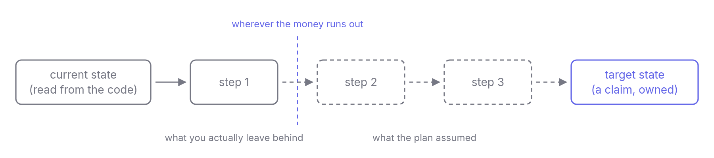
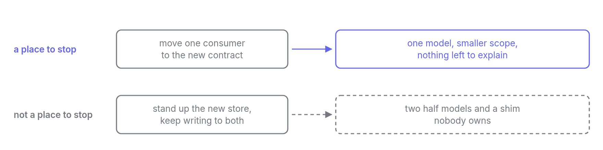

# Design the Stopping Point

*Target state is the easy half of a solution design. The hard half is the first step, because that is usually where the money runs out.*

An engineering director asked me a question I couldn't answer cleanly, which is how I knew it was a good one.

We were mapping the delivery lifecycle on a whiteboard. Where discovery ends, where execution begins, who hands what to whom. Discovery produces a solution design. Execution produces working software. Two clean boxes and one clean arrow between them. Then he tapped the arrow. "What actually travels along it?"

I had a target state. I always have a target state. What I didn't have was a good answer about the thing in the middle, and for years I had filed it under delivery's problem.

## Two worlds, and only one of them should be drawn by a human

A solution design describes two worlds.

The first is the system as it stands today. A person should barely write that description at all. It should be read out of the code, the pipelines, the infrastructure definitions, whatever a tool or an agent can see for itself. This has stopped being an aspiration: reading an existing system is the one job the current crop of agents does better than writing into it, and comprehension is exactly where they are cheapest to trust.

The moment a current-state diagram becomes an opinion, it becomes a flattering one. Nobody draws their own system messier than it is. I have argued the harder version of this before: [a model that no compiler checks will drift](/blog/the-diagram-that-cannot-lie/).

The second world is the target state. What the system looks like once the requirement is genuinely met. That one is a claim about a future that doesn't exist yet, so a named human has to own it.

Both are comfortable to produce. The design reviews well, the boxes are legible, the room nods. Then execution starts, and the two worlds turn out to be separated by something nobody drew.



## Debt is not created at design time

One sentence from that conversation reorganized how I work.

A design does not create technical debt. It cannot. It is a document. It has never touched a running system, never shipped a schema, never left a compatibility shim in place for three years.

Debt appears the moment execution stops somewhere other than the target state. And it almost always does. Budgets are annual, priorities rotate, and the reorganization doesn't read your migration plan ;)

I have watched initiatives with genuinely good designs leave systems worse than they found them. Not because the design was wrong. Because the funding ended between step two and step three, in a place nobody had ever considered as a resting position.

**A design cannot owe anything. Only a half-built system can.**

Which moves the interesting work. Not to the destination. To the shape of the trail.

## Make every step a place the system can live

So the question I now ask before a first step is not whether it moves us toward the target. Almost anything does. It is: **if this turns out to be the last step we ever fund, what have we left behind?**

A step that passes is a resting position: a place the system can stop and live for two years without apology. Three properties, in the order I check them:

- **It stands alone.** After the step, the system is internally consistent. One model at a smaller scope, not two half-models with a translation layer nobody owns.
- **It is reversible, or it is finished.** Either the step walks back with a configuration change, or it completed something. What I avoid is the middle: irreversible and unfinished. Decomposing until [every step is a two-way door](/blog/the-migration-that-never-starts/) is the same instinct pointed at a different problem.
- **It closes an option on purpose.** A good step removes a path and names which one. A step that keeps every option open has not decided anything. Optionality feels like prudence long after it has quietly become an unpaid invoice.



## Write the stopping point down, not just the destination

The artifact this produces is small. One page, next to the solution design.

The first step. What it deliberately leaves unfinished. The risk of that state persisting for two years, in plain words rather than a severity colour. The name of the person who accepted that risk. And a trigger: the event that makes revisiting it mandatory, so that "not yet" has an alarm attached instead of a hope.

```
step 1:        …
unfinished:    …
risk if this lasts 2 years:  … (plain words, no severity colour)
accepted by:   <a name, not a role>
revisit when:  <the event that makes "not yet" expire>
```

That last part I stole from my own hobby repository, where one decision record exists purely to [record a decision not to decide, with a written trigger](/blog/adrs-for-an-audience-of-one/). It transfers to organizational scale better than it has any right to.

It also answers the question every engineering director eventually asks. Should the architect be hard on quality, or should the architect plan the shortcut? Neither is the job. **The job is to make the shortcut legible.** Say exactly what is being traded, for how long, and by whom. Then the organization is choosing rather than drifting.

The objection I hear is that writing the shortcut down blesses it, that planning the resting position means giving up on quality. But the shortcut doesn't wait for a blessing. It happens either way. The only choice on offer is whether it is chosen or discovered.

An accepted risk with a name on it is engineering. The same risk unnamed is just something that happened to you.

## What it changed

That whiteboard conversation never produced a clean answer, and I stopped expecting one. What it changed was smaller than an answer.

I still deliver a target state. I still let a tool draw the current one. But the page I spend the longest on now is the shortest of the three: the first step, what it deliberately leaves undone, and the name of the person who agreed to live with that.

It takes an hour to write. It is also the only part of the plan I can be sure will happen, because it happens first. And often enough, it turns out to be the part that happens last.

The design never owed anything. The trail did.

---

**Scores:** tension=7 originality=7 personal=7 contrarian=7 substance=8 punch=8 trend=6
**Scored:** 2026-07-27 rubric=v1 model=claude-fable-5

**Publish:** 2026-08-10 09:00

**Tags:** Software Architecture, Technical Debt, Decision Making, Engineering Leadership, Systems Thinking
