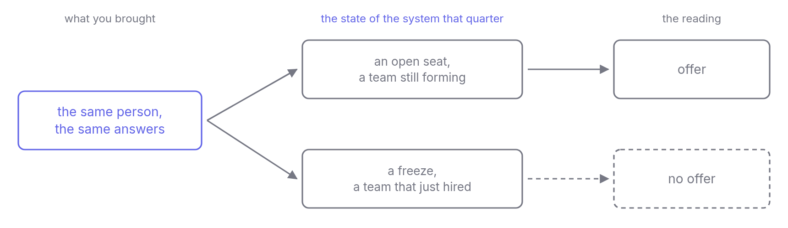

# Count Your Rejections

*A friend passed every round and still did not get the job. Nothing was wrong with him. The company simply had no seat that quarter.*

A while ago my phone rang with a name I had not seen in a long time. Early in my career he had been the more experienced one, the person I walked over to when I was stuck. Now he was calling to ask how things were going with me, in the particular tone people use when things are not going well with them. He had landed somewhere wrong.

I remembered his interview at the company I worked for back then. I had been certain about him, and the loop agreed. Five rounds, five yes. He did not get the job.

Not because of anything he said, or did, or failed to know. The headcount moved.

That call rearranged something I had believed for a decade. Private notes from one career, no study behind them.

## What five out of five actually measured

An interview loop is not measuring your worth, and it is not really trying to. It is managing somebody else's risk at scale, and it does that inside constraints that have nothing to do with you. An open seat. A budget cycle. The current shape of a team. A manager's memory of their last bad hire. I have written before about [the loop as a risk function rather than a verdict](/blog/grinding-dijkstra-at-senior-level/), and every year since has made me more confident that this is the right reading.

Competence is one input. It is a real input, and it is the only one you can prepare. But it gets scored against a system state you were never shown, and that state changes week to week.

Which makes a rejection a reading with two operands. Your skills are one of them. **The other is a system nobody described to you.**

## The years I misread the room

I spent the early part of my career as a consultant, which meant a new project every few months and a lot of first conversations. Two or three a year, sometimes more.

I got good at feeling the outcome early. Ten minutes into a conversation you can usually tell whether anything will come of it. What I could not do was name what I was feeling, so I explained it to myself with the only vocabulary I had: they must have wanted somebody more technical.

They usually did not. What was actually being read was whether I could get a thought out of my head and into somebody else's without requiring them to already share my context. Whether I would be pleasant to disagree with at four in the afternoon in a bad week. Whether I asked them anything at all.

I have made a kind of peace with still not being good at the first one. Moving a fully formed idea into another person's head is genuinely hard for me, harder than any system I have been handed to design. That is not modesty. It is the largest gap on my own list, and I know it is there because rejections kept saying so, for years, long before I was willing to hear it.

## Depth alone has become a fragile position

It also explains why I have gone cold on the model everyone quotes. The T shape: broad awareness across many areas, deep expertise in one.

The vertical stroke still pays. But maximizing it alone has become a genuinely risky career position, and not for the reason usually given. It is not mainly that agents write code now, although that matters. It is that the scarce thing in any organization is someone who can hold a system-level view *and* be worked with. Depth without the horizontal stroke produces a person who is right often and expensive to be around, and organizations quietly route around expensive-to-be-around. They do it without malice and usually without noticing.

A colleague I still respect enormously put it better than I have managed since. If you are right and you were unpleasant about it, you are still unpleasant. If you are wrong and you were decent about it, you were merely wrong.

The second position is recoverable in an afternoon. The first one compounds. It is the individual version of the failure I described in [Mathematicians vs. Lawyers](/blog/mathematicians-vs-lawyers/): a room that can only think one way is not strong, it is brittle.

## Make it a KPI

The practice itself is small, and it is the part I would defend in any review.

Track your rejections. Not to punish yourself. To check that you are still asking for things.

A year with zero rejections is not a year in which you were universally correct. It is a year in which you applied for nothing, proposed nothing that could fail, and asked for no budget you had not already been promised. **A year without rejections is not a good year. It is a small one.**

Two habits turn the number into an instrument rather than a bruise:

- **Separate the reading from the verdict.** Write down what was actually declined. Nine times out of ten it was a fit, a timing, or a seat. One time in ten it is a real gap, and that one is a piece of feedback you got for free that most people pay a career to learn.
- **Ask again.** Nothing about an organization is stable. The manager with no seat in March has been reorganized by September. The proposal that was too early last quarter is obvious this one. The same request, unchanged, meets a different system and gets a different answer, and almost nobody tries twice.

My friend, the one who called: he took a very good job about a year after the five out of five. Same skills. Different quarter.

## Try this

Count the times you were told no in the last twelve months. Sort them into two piles: the ones that were about you, and the ones that were about the state of the system on that particular Tuesday.

If the second pile is bigger, you have spent a year collecting evidence about other people's constraints and filing it under your own competence. Move it to the right folder and go ask for something.

And if both piles are nearly empty: what did you decide not to ask for this year, and who exactly told you no before you did?

---

**Scores:** tension=7 originality=5 personal=9 contrarian=7 substance=6 punch=8 trend=3
**Scored:** 2026-07-27 rubric=v1 model=claude-opus-5

**Publish:** 2026-09-07 09:00

**Tags:** Career Development, Engineering Leadership, Personal Growth, Corporate Culture, Technical Interviews
