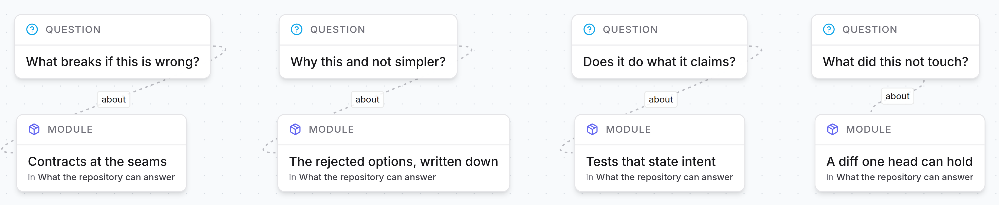
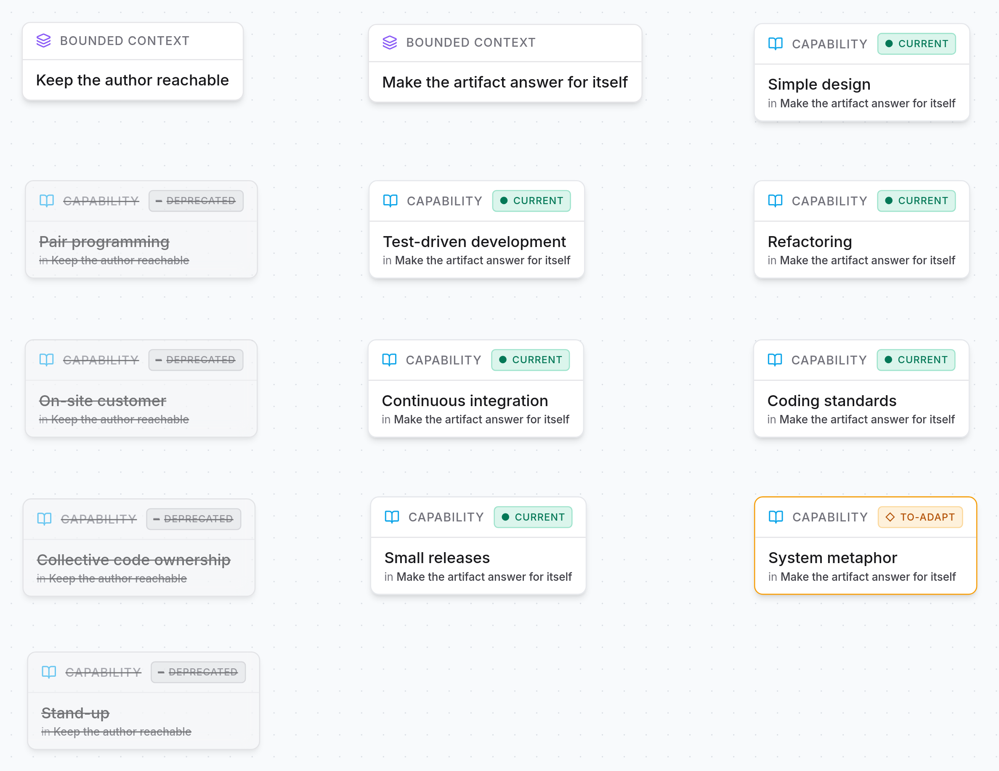

# We Deleted the Wrong Half of Agile

*Reviewability is something you design. Extreme Programming already knew how, and we made exactly the wrong half of it optional.*

At 11:45 in the morning, my manager told me I had buried the point of my own essay.

He had read [The Bottleneck Moved](/blog/the-bottleneck-moved/), the one about review queues filling with code no human wrote. His verdict, in the channel, unedited: the bottleneck is just context in my view. The part worth writing about was a single line near the end, where I said reviewability is a system property and then walked straight past it.

Then he added the sentence I have not stopped chewing on. Agent SDLC should bring new concepts or resurrect XP practices, he wrote, and put "the true agile" in brackets.

He was right about the burial. These are notes from inside one transformation, mine, with all the sampling problems that implies, but the arithmetic was hard to argue with: I had spent eleven hundred words describing a queue, and exactly one sentence on the only part of it I can design.

## What the property is, exactly

Start with what a reviewer does. Not the ritual. The actual cognitive act.

You open a diff and a question forms. Then a second one. Historically each question had a destination: the person who wrote it, three desks away, still holding the answer in their head. Review felt like a technical act because the social half was invisible and fast.

Take the author away and the questions do not disappear. They just have nowhere to go.

So here is the definition I have been using since that message. **A system is reviewable to the degree that a reviewer's questions have destinations that are not a person.** Four questions cover most of what I have watched people actually ask, across fifteen squad reports a month and my own miserable weekends as a one-person review queue:

What breaks if this is wrong? Why this way and not the obvious simpler way? Does it do what it claims to do? And what did this not touch that I assumed it would?

Every one of those has an artifact-shaped answer available. Blast radius is answerable from the diff when contracts sit at the seams and modules have real boundaries. The rejected alternative is answerable from a decision record, which is the only reason to write one. Whether it does what it claims is answerable from tests that state intent rather than pin implementation, so a green suite means something specific instead of meaning nothing loudly. Scope is answerable from size. That is the entire case for small changes, and it survived every fashion that tried to kill it.

None of that is exotic. That is the uncomfortable part.

## The half we made optional

Kent Beck put twelve practices in *Extreme Programming Explained* in 1999. Read the list now, with agents in your peripheral vision, and it splits cleanly into two jobs.

One group keeps the author reachable: pair programming, on-site customer, collective code ownership, the stand-up. The other group makes the artifact answer for itself: test-driven development, continuous integration, small releases, simple design, refactoring, coding standards.

Scrum industrialised the first job. It has no engineering practices at all, by design, and that was not a scandal for the first decade because the second group survived as craft culture in teams that cared. Martin Fowler named the failure mode in 2009 and called it [FlaccidScrum](https://martinfowler.com/bliki/FlaccidScrum.html): the ceremonies running perfectly while the codebase rotted underneath them. Everyone I knew read that piece and agreed with it. Then we filed it as a maturity problem. Something to get to after the reorg.

Then the author stopped existing.

Every practice in the first group assumes a counterparty who can still be asked. You cannot pair with a session that closed. Collective ownership of code that nobody wrote is a sentence missing its subject. The half of agile that survived twenty years of process consulting is the half that needs a human on the other end of the question. **And the half we were allowed to skip is the one that had been carrying the arrangement all along.**

That is not an argument for going back. Most of XP's first group is still how humans work well together, and I would not run a team without it. It is an argument about which practices are load-bearing now rather than merely good. We spent two decades filing the load-bearing ones under optional, because a human in the room could always cover for them.

## The practice everybody mocked came back with a filename

There is one genuinely new thing here, and it arrived in the most embarrassing way possible.

System metaphor was XP's weakest practice. The one Beck had the hardest time explaining, and the one teams dropped first: a shared story of how the system works, with no artifact attached to it. It sounded like poetry in a discipline that wanted checklists. So it evaporated.

It has a path now. `CLAUDE.md`, `AGENTS.md`, whatever your tool calls its rules file. We started writing them because a model needed orientation before it could touch anything. What came out was a document describing what the system is, and where the bodies are buried. Then the new joiner reads it on day one and gets more from it than from the wiki.

We needed a non-human reader before we would write down the thing we had refused to write down for twenty years. I find that funny in a way that does not fully sit well.

## The objection I keep running into

Pair with the agent. Review at write time, watch each change land, and the authorless diff never forms in the first place.

This is the strongest counterargument and it is partly right. Pairing with an agent does move review earlier, and earlier review is cheaper review; that has been true since long before any of this. So far, so good.

But it only holds while a human stays the counterparty. If the person who ran the prompt can still answer for the diff on Thursday then the practice survives intact and the theory has somewhere to live, and if they are meeting the output at the same moment the reviewer is, then nothing was paired at any point. Something was generated and forwarded.

Which gives one standard worth adopting tomorrow, and it costs nothing: **"I just ran the agent" is not an acceptable answer in a review.** Whoever sends the change is the counterparty for it. That is not a process change, and no tool enforces it. It is a thing a team either expects of each other or does not.

I do not know where the ceiling on this sits. Some questions may simply have no artifact-shaped answer, and the honest response to those is to not merge. Which is a far less comfortable conclusion than the one about tooling.

## You have been measuring it for years

Here is the part that made me stop treating this as a coding-standards problem.

A new joiner is a reviewer with no context. Everything that makes a system hard to review makes it hard to join, for exactly the same reason. The questions have no destination, so they route to whoever has been there longest, and that person becomes the bottleneck by seniority rather than by design. **Reviewability and onboardability are the same property, looked at from two ends.**

Which means the metric already exists and you have been collecting it. Time to a new joiner's first merged change is a reviewability number, and it has been sitting in an HR dashboard being read as a statement about the person.

If you want a faster reading, take your last ten merged pull requests and count the times somebody had to ask a human something the repository could have answered. Divide by ten. That is roughly what each authorless diff is about to cost you. Most numbers in this area take a quarter to produce; this one takes an afternoon. And if it comes back zero while your review queue is still three days deep, my argument is wrong, and I would rather hear that than be agreed with.

## What I did not see until he named it

The thing I keep turning over is that I had already built this and could not see it.

The architecture tool I build at night exists so that editing an element on a canvas produces a Git diff containing that edit and nothing else. No reordering. No reformatting. No comment lost. I built it because [diagrams drift](/blog/the-diagram-that-cannot-lie/), and I wanted one that could not. It took somebody reading my own essay back to me to name what I had made. Blast radius legibility, the first of the four questions, built into a product.

The practices were on the shelf all along. We labelled them engineering hygiene, which is what a discipline calls the thing it means to skip. Twenty years later the one participant who could cover for their absence stopped showing up to the review.

I still read fifteen reports a month. What I look for now is not the ageing queue. I know how to find that. It is the sentence where somebody explains that they had to go and ask. Then the part where they say who.

---

**Scores:** tension=7 originality=6 personal=7 contrarian=8 substance=8 punch=7 trend=8
**Scored:** 2026-08-07 rubric=v1 model=claude-opus-5

**Publish:** 2026-09-07 09:00

**Tags:** Software Architecture, Engineering Leadership, AI Transformation, Organizational Culture, Systems Thinking
