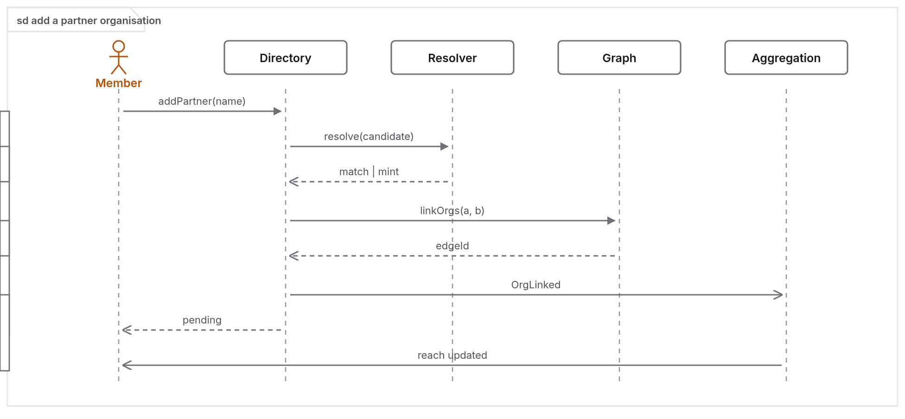

# Turn the Sequence Diagram on Its Side

*A lifeline is a line, and nothing fits on a line. Turn the picture sideways and every participant gets a band you can write in.*

Two weeks ago I sent an architecture design for review. Seven pages, for a room of architecture stakeholders. When I briefed the AI agent that drew it with me, I asked for "C1, C2 and maybe some data flow diagram." In that order. The flow was an afterthought.

Not one person commented on the container page. I had spent the longest on it.

Both flow pages came back covered in comments. One started an argument that ran for two days and moved a boundary. This happens often enough that I have stopped calling it luck. The flow pages were the only ones with team names on them. You can count a picture that has team names on it.

## A lifeline is a line

Somebody names another company as a partner. The platform has to answer one question: is this company already in our graph, or is it new?

That is a correct sequence diagram. Frame, activation bars, real returns, open arrowheads on the messages nobody waits for. I want to say that clearly before I start complaining.

Now what is true here and nowhere on the page.

Identity matching runs on a confidence score. Below the threshold we reject nothing. We create a second company instead, and it never merges back. Two in five arrive with no registration number. One new edge makes us recompute a number for every node above it, in a graph 40 million deep. Four of these five participants already exist. One is new.

You could say that sequence notation cannot show any of that. It can. UML has a state invariant for the duplicate, an `opt` fragment for the missing number, a `ref` for the matching logic. All legal. All of it also makes the picture wider, and costs a reader who knows those symbols.

So the limit is not what the notation can express. The limit is space. **An arrow label holds about four words before it touches the next one.** The rest of this post follows from that number.

Put everything else in a paragraph underneath, and you have built a known problem on purpose. Chandler and Sweller measured it in 1991 and called it the [split-attention effect](https://bpspsychub.onlinelibrary.wiley.com/doi/abs/10.1111/j.2044-8279.1992.tb01017.x). Split what a reader has to combine, and they get less from both halves.

## What a band has room for

So turn it sideways. Participants down the left, time across the bottom.

Same five participants. Same eight messages. Same shape, because Directory still waits for both answers and still sends the event at the end. That is what the grey bar means.

One thing is different. A row has height. So a step is a box that holds about 25 words, not an arrow that holds four.

Three rules use that space, and together they are the whole notation:

- the lane label carries the owning team, not only the service name
- the box carries how the step works, not the name of the method
- one note box carries the reason, because the reason disappears first

## What comes back is different

I did not expect this part. The number of comments stayed the same. The kind of comment changed.

Send a sequence diagram round, and half of what comes back is about the notation. Does this dashed arrow mean async, or a return? Is anybody blocked here? Fair questions. Not one of them is about the design. You spend the review teaching people to read the picture, and the picture was supposed to be the cheap part.

Send the lane version, and the questions are about the system instead. Why does this cross my team? What happens to a company we created twice? Who picks that up?

Nobody has ever asked me what a lane means. A row with a squad name needs no explaining. That is the difference between a diagram people review and one they approve.

The bigger surprise was who joined in. Product people read these without any training, and I have stopped expecting anyone outside engineering to read a sequence diagram. **The people who can tell you a boundary is wrong are often the same people who were never going to read UML.**

## Count the handovers, not the arrows

This is the part worth the effort. It costs one line per lane.

Write the owning team next to each participant. The picture is no longer five services. It is four squads with three handovers, and **each handover is a conversation somebody has to have before any code gets written.**

Count them carefully, because this is where the idea gets used wrongly. Do not count arrows. Two lanes owned by one squad make a crossing but no conversation. Six arrows between the same two squads are still one conversation. Count the team pairs that hand each other something.

On the page I sent for review, 8 lanes and 14 steps came down to 3 teams and 3 pairs. It also broke my own rule about splitting past 6 lanes. Breaking it was the warning.

That number belongs next to the estimate. It counts the roadmap slots you need inside other teams, and the people who can say no.

None of this came from software. Rummler and Brache made the swimlane popular in *Improving Performance: How to Manage the White Space on the Organization Chart*. Their finding was simple. Processes do not fail inside departments. They fail at the handoffs between them. (A famous 80% is attached to that. I could not find the source.)

A sequence diagram has no white space to point at. Its participants are objects. Objects do not have managers, quarters, or a backlog that is already full.

The note box ends with a line I now put on all of them. Whose ticket this is gets agreed here, or it gets agreed during an incident.

## Yes, this is a swimlane

Somebody will say it, so I will.

[BPMN](https://www.omg.org/spec/BPMN/2.0/) has had pools and lanes since 2004, and a lane already means the responsible team. UML has activity partitions, which are swimlanes, in the same specification as the sequence diagram I have been arguing with. PlantUML takes `|Identity|`. Mermaid has them too. The rotation is twenty years old. None of it is mine.

What I have not found anywhere is the discipline. BPMN lanes carry a role, then hide the reasoning in a properties panel. PlantUML gives you one line per step. None asks for the mechanism. None makes you write down what the picture will cost in other people's quarters.

## What I still cannot do

Returns. A sequence diagram shows exactly when control comes back. My grey bar only shows that somebody is still holding it.

The tooling is worse than it looks. These pictures come from a model file through a generator, so they diff and regenerate. The skill below does not. It makes an agent write absolute coordinates, the dead artifact I complained about in [The Diagram That Cannot Lie](/blog/the-diagram-that-cannot-lie/). I know roughly how to fix it. I have not done it.

Then the part I like least. Open one on a phone and the text in the boxes drops below 4px. **A notation whose only advantage is text density is the one a narrow screen hurts most.** It is a desktop artifact, and I have no answer.

## Take the notation, not the picture

The pictures here are worth nothing to you. The notation might be. So it is a file, not advice. Drop `SKILL.md` into `.claude/skills/`, describe a flow, get a `.drawio` back.

**[SKILL.md](/assets/skills/lane-flow-diagram/SKILL.md)** ⋅ MIT, no attribution needed, swap the palette for your own.

Its last section is a checklist. That is the part I would keep if I had to throw away the rest. One question asks how many team handovers the picture holds, and whether that number sits next to the estimate.

The drawing takes a minute now. Working out which teams belong in the room still takes the week it always took.

---

**Scores:** tension=7 originality=6 personal=7 contrarian=6 substance=8 punch=8 trend=7
**Scored:** 2026-08-13 rubric=v1 model=claude-opus-5

**Publish:** 2026-09-14 09:00

**Tags:** Software Architecture, Systems Thinking, Organizational Design, Engineering Leadership, Artificial Intelligence
