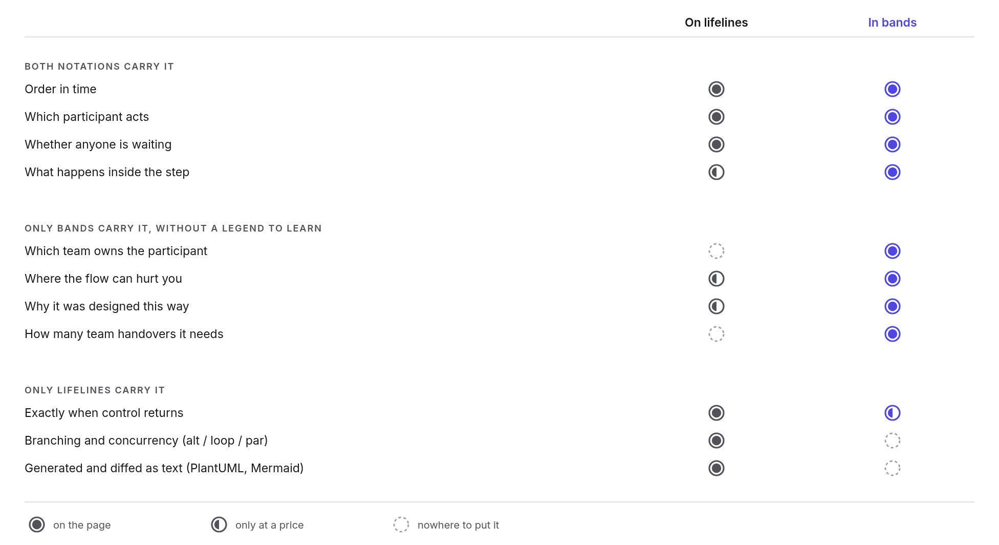

# Turn the Sequence Diagram on Its Side

*The people who can tell you a boundary is wrong were never going to read UML. Turn the sequence diagram on its side and they do not have to.*

In August I sent an architecture design for review: seven pages, for a room of architecture stakeholders. Two pictures go into every design I send out now: one shows how the capability map changes, the other shows the flow. Back then the flow was an afterthought. My brief to the AI agent that drew it with me was "C1, C2 and maybe some data flow diagram", in that order, and the container page got most of my time.

Nobody commented on the container page. Both flow pages, on the other hand, came back covered in comments. One started an argument that ran for two days and moved a boundary. That was no accident. The flow pages were the only ones that said which part of the organization owned each step. A picture that says who owns what is a picture people can argue with.

That is the bridge between an architecture and the organization it lands in. A design without that bridge is the usual ivory tower, approved and built by nobody. This one came down to the ground, into the problem the teams in that room were living with, and adoption followed at once. [Adoption is the only measure of a design I still trust](/blog/adoption-is-the-deliverable/), and this post is about the picture that produced it.

## A lifeline is a line

The domain first. The platform models a graph of relations between organizations, worldwide, and one of its hard problems is deciding automatically whether a company somebody just named is one we already know. So take that flow: a partner gets named, and before anything else can happen the platform has to answer, already in our graph, or new?

That's a correct sequence diagram, with a frame, activation bars, real returns and open arrowheads on the messages nobody waits for. My complaint is about everything that is true here and shows up nowhere on the page.

Identity matching runs on a confidence score, and below the threshold we reject nothing. We create a second company instead, and it never merges back. Two in five of these partners arrive with no registration number at all. One new edge makes us recompute a number for every node above it, in a graph 40 million deep. Of the five participants in the picture, four already exist. One is new.

Sequence notation can show all of that. UML has a state invariant for the duplicate, an `opt` fragment for the missing number and a `ref` for the matching logic, all of it legal, and all of it also makes the picture wider and costs you a reader fluent in those symbols.

So the notation can express everything I listed. What it runs out of is room, and with room the amount of information one picture can carry. **An arrow label holds about four words before it touches the next one**, and a sequence diagram spends almost all of its capacity on control flow. The rest follows from that.

Put everything else in a paragraph underneath the picture and you have built a known problem on purpose, one Chandler and Sweller measured in 1991 and called the [split-attention effect](https://bpspsychub.onlinelibrary.wiley.com/doi/abs/10.1111/j.2044-8279.1992.tb01017.x): split what a reader has to combine, and they get less from both halves.

## What a band has room for

So turn it sideways. Participants go down the left and time runs across the bottom.

The same five participants are there, with the same eight messages and the same shape, because Directory still waits for both answers and still sends the event at the end. That is the grey bar. One thing changed: a row has height. So a step becomes a box holding about 25 words, instead of an arrow holding four.

Three rules spend that space, and they are the whole notation. The lane label carries the owning domain, and every domain has an owner in the organization, which is how a lane ends up with a team name on it. The box carries how the step works rather than the name of the method. And one note box carries the reason, because the reason is what disappears first.

## What comes back is different

I didn't expect this part. The number of comments stayed the same, but the kind of comment changed.

Send a sequence diagram round and half of what comes back is about the notation. Does this dashed arrow mean async or a return? Is anybody blocked here? Fair questions. Not one of them is about the design, though. So you spend the review teaching people to read the picture, and the picture was supposed to be the cheap part.

Send the lane version instead and the questions are about the system. Why does this cross my team? What happens to a company we created twice, and who picks that up? Nobody's ever asked me what a lane means, because a row with a squad name on it needs no explaining. That is the difference between a diagram people review and one they approve.

The bigger surprise was who joined in, because product people read these without any training, and I had stopped expecting anyone outside engineering to read a sequence diagram at all. **The people who can tell you a boundary is wrong are often the same people who were never going to read UML.**

## Count the handovers, not the arrows

This is where the effort pays, and it costs one line per lane. Write the owning domain on each lane, and since every domain has a team behind it, five services become four squads with three handovers. **Each handover is a conversation somebody has to have before any code gets written.**

Count them carefully. This is where the idea gets used wrongly. Don't count arrows. Two lanes owned by one squad make a crossing but no conversation, and six arrows between the same two squads are still one conversation. What you count is the pairs of teams that hand each other something.

On the page I sent for review, 8 lanes and 14 steps came down to 3 teams and 3 pairs. The same page broke my own rule about splitting past 6 lanes, which should have been the warning. That number belongs next to the estimate, because it counts the roadmap slots you will need inside other teams and the people who can say no.

None of this came from software. Rummler and Brache made the swimlane popular in *Improving Performance: How to Manage the White Space on the Organization Chart*. Their finding was simple: processes do not fail inside departments, they fail at the handoffs between them. A famous 80% is attached to that. I couldn't find the source. A sequence diagram has no white space to point at, because its participants are objects. Objects do not have managers, quarters, or a backlog that is already full.

The note box ends with a line I now put on all of them: whose ticket this is gets agreed here, or it gets agreed during an incident.

## Yes, this is a swimlane

Somebody will say it. So I will. [BPMN](https://www.omg.org/spec/BPMN/2.0/) has had pools and lanes since 2004, UML has activity partitions in the same specification as the sequence diagram, PlantUML takes `|Identity|`, and Mermaid has them too. The rotation is twenty years old. None of it is mine.

What I haven't found anywhere is the discipline. BPMN lanes carry a role and hide the reasoning in a properties panel, PlantUML gives you one line per step, and none of them asks for the mechanism or for what the picture will cost in other people's quarters.

## What I still cannot do

Returns, for one. A sequence diagram shows exactly when control comes back, while my grey bar only shows that somebody is still holding it.

The tooling is worse than it looks. These pictures come from a model file through a generator, so they diff and regenerate. The skill below writes absolute coordinates instead, the dead artifact I complained about in [The Diagram That Cannot Lie](/blog/the-diagram-that-cannot-lie/). I know how to fix it. I haven't.

Then the one that bothers me. Open one of these on a phone and the text in the boxes drops below 4px. **A notation whose only advantage is text density is the one a narrow screen hurts most.** It's a desktop artifact. I have no answer for that.

## Take the notation, not the picture

The pictures here are worth nothing to you, but the notation might be, so it is a file rather than advice. Drop `SKILL.md` into `.claude/skills/`, describe a flow, and get a `.drawio` back.

**[SKILL.md](/assets/skills/lane-flow-diagram/SKILL.md)** ⋅ MIT, no attribution needed, swap the palette for your own.

Its last section is a checklist, the part I'd keep if the rest went. One of its questions asks how many team handovers the picture holds, and whether that number sits next to the estimate.

Send me one of yours with the team names on it. I want to know how many conversations you count.
---

**Scores:** tension=7 originality=6 personal=7 contrarian=6 substance=8 punch=8 trend=7
**Scored:** 2026-08-13 rubric=v1 model=claude-opus-5

**Publish:** 2026-09-14 09:00

**Tags:** Software Architecture, Systems Thinking, Organizational Design, Engineering Leadership, Artificial Intelligence
