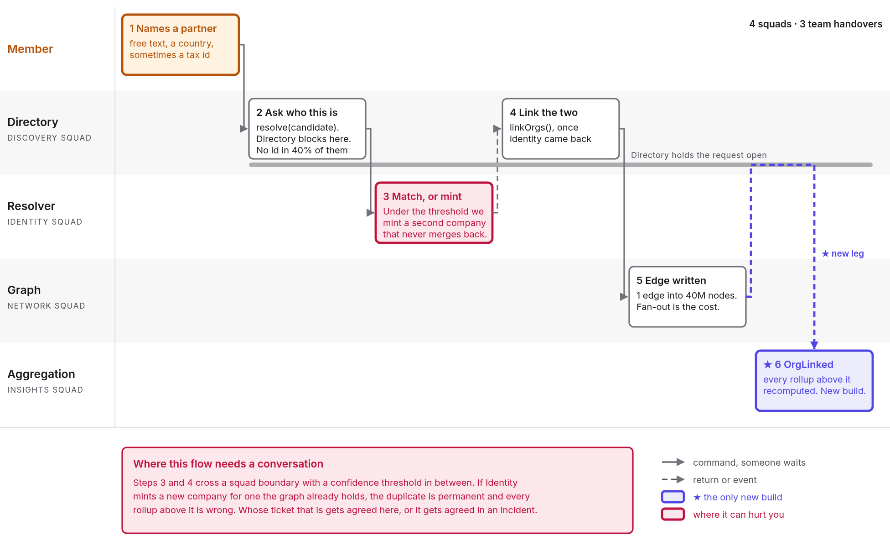

# Turn the Sequence Diagram on Its Side

*A lifeline is a line, and you cannot write on a line. The rotation is the boring part. What you are finally allowed to put in the space is not.*

Two weeks ago I sent a design round for review. Seven pages. When I briefed the agent that helped me draw it, I asked for "C1, C2 and maybe some data flow diagram." In that order. The flow was the afterthought.

Nobody said one word about the container page.

Both flow pages came back marked up, and one started an argument that ran two days and moved a boundary. That has happened often enough that I have stopped calling it luck. The flow pages were the only ones with team names on them. A picture with team names on it can be counted.

## A lifeline is a line

Somebody names another organisation as a partner, and the platform has to work out whether it is already a node before it can draw the edge.

Frame, activation bars, real returns, open arrowheads on the messages nobody waits for. UML doing what UML is good at. I want that stipulated before the next paragraph.

Now the things that are true here and nowhere on the page. Identity matching runs on a confidence score, and under the threshold nothing is rejected: a second company is minted and never merges back. Two in five arrive with no registration number. One new edge recomputes a rollup for every node above it, in a graph 40 million deep. Four of these five participants exist. One is new.

The lazy claim is that sequence notation cannot express any of that. It can. A state invariant on the lifeline for the duplicate, an `opt` fragment around the missing-registration path, a `ref` to the matching sub-interaction. All legal UML. Each one also widens the picture or stretches the time axis, and costs you a reader who knows that glyph family.

So the limit is not capability. It is room. **An arrow label fits about four words before it collides with its neighbour**, and the rest of this post follows from that number.

Put the remainder in a paragraph underneath and you have built the [split-attention effect](https://bpspsychub.onlinelibrary.wiley.com/doi/abs/10.1111/j.2044-8279.1992.tb01017.x) on purpose, which Chandler and Sweller measured back in 1991: split what a reader has to hold together and they get less out of both halves than if you had merged them.

## What a band has room for

So rotate it. Participants down the left, time across.

Same five participants, same eight messages, same shape. Directory still blocks on both calls and still emits the event at the end. That is what the grey bar says. One thing changed. A row has height, so a step is a box carrying about 25 words instead of an arrow carrying four.

Three rules spend it. The lane label carries the owning team, not just the service name. The box body carries the mechanism, not the method name. One note box carries the reason, because the reason is the first thing to go missing.

## What comes back is different

The part I did not expect was that the kind of comment changed, not the number of them.

Send a sequence diagram round and half of what you get back is about the notation. Does that dashed arrow mean asynchronous, or does it mean a return. Is anybody blocked here. All fair questions, and not one of them is about the design. You spend the review teaching people to read the picture. The picture was supposed to be the cheap part.

Send the lane version and the questions arrive about the system instead. Why does this cross my team. What happens to a company that gets minted twice. Who picks that up.

Nobody has ever asked me what a lane means. A row with a squad name needs no explaining, and that is the difference between a diagram people review and one they approve.

Who joins in surprised me more. Product read these without being taught, and I have stopped expecting anyone outside engineering to read a sequence diagram at all. **The people who can tell you a boundary is wrong are very often the same people who were never going to read a sequence diagram.**

## Count the handovers, not the arrows

The part worth the trouble is one line per lane.

Write the owning team next to each participant. The picture stops being five services and becomes four squads with three handovers between them, and **a handover is a conversation somebody has to have before any of this gets built.**

Count them properly, because this is where the idea gets misused. Not arrows crossing lanes. Two lanes owned by one squad make a crossing and no conversation, six arrows between the same two squads are still one conversation, and what you want is the number of distinct team pairs that hand each other something. On the page I sent for review, 8 lanes and 14 steps collapsed to 3 teams and 3 pairs. It also broke my own rule about splitting past 6 lanes. Breaking it was the tell.

That number belongs next to the estimate. It counts the roadmap slots you need inside other teams, and the people who can say no.

None of this came from software. Rummler and Brache popularised the swimlane in *Improving Performance: How to Manage the White Space on the Organization Chart*, on the observation that process failures cluster at the handoffs between departments rather than inside them. (A famous 80% is attached to that. I cannot source it.)

A sequence diagram has no white space to point at. Its participants are objects, and objects do not have managers, quarters, or a backlog that is already full.

The note box ends with the line I now put on every one of these: whose ticket that is gets agreed here, or it gets agreed in an incident.

## Yes, this is a swimlane

Somebody is about to say it, so I will.

[BPMN](https://www.omg.org/spec/BPMN/2.0/) has had pools and lanes since 2004, and a lane already means the team responsible. UML ships activity partitions, which are swimlanes, in the same specification as the sequence diagram I have been arguing with. PlantUML takes `|Identity|`. Mermaid has them now. The rotation is twenty years old. None of it is mine.

The discipline is what I have not found in any of them. BPMN lanes carry a role, then bury the rationale in a properties panel. PlantUML gives you one line per step. None asks for the mechanism. None makes you write down what the picture will cost in other people's quarters.

## What I still cannot do

Returns. A sequence diagram shows precisely when control comes back; my grey bar only says it is held.

The tooling is worse than it looks. These pictures come out of a 150-line model file through a generator, so they diff and regenerate. The skill below does not. It has an agent emit absolute coordinates, the fragile dead artifact I complained about in [The Diagram That Cannot Lie](/blog/the-diagram-that-cannot-lie/). I know roughly what the fix is. I have not written it.

Then the one I like least. Open one on a phone and the box bodies land under 4px. **A notation whose whole advantage is text density is the one a narrow column punishes hardest.** A desktop artifact, and I have no answer.

## Take the notation, not the picture

The pictures here are worth nothing to you. The notation might be, so it is a file rather than advice. Drop `SKILL.md` into `.claude/skills/`, describe a flow, get a `.drawio` back.

**[SKILL.md](/assets/skills/lane-flow-diagram/SKILL.md)** ⋅ MIT, no attribution needed, swap the palette for yours.

Its last section is a checklist. That is the part I would keep if I had to throw the rest away. One question asks how many team handovers the picture holds, and whether that number sits next to the estimate. It has changed more designs than any arrow I have drawn.

The drawing takes a minute now. Working out which teams belong in the room still takes the week it always took.

---

**Scores:** tension=7 originality=6 personal=7 contrarian=6 substance=8 punch=8 trend=7
**Scored:** 2026-08-13 rubric=v1 model=claude-opus-5

**Publish:** 2026-09-14 09:00

**Tags:** Software Architecture, Systems Thinking, Organizational Design, Engineering Leadership, Artificial Intelligence
