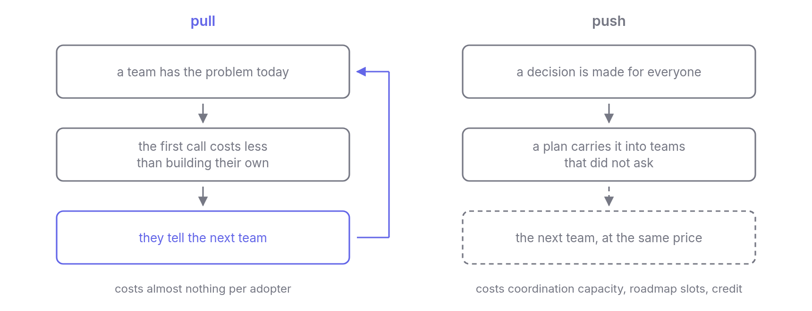
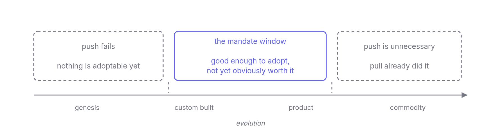

# Adoption Is the Deliverable

*The ugliest service in production beats the most elegant one nobody calls. So where exactly does an architect's job end?*

Two services on a platform I worked on solved roughly the same problem. One was built properly: clean boundaries, a published contract, a model that made sense if you read it cold. The other was a lump. Ambiguous naming, a schema that had recorded somebody's Tuesday, no versioning story worth the name.

Four teams integrated with the lump.

I spent a while explaining to myself why that was the organization's failure. It was not. Field notes from one platform, not a study, but I have stopped arguing with the result: the lump was closer to what people needed on the day they needed it, and closeness beat elegance by a distance no design review was ever going to close.

## The responsibility line is drawn in the wrong place

Ask most architects where their job ends and you get a version of: at the design, or at the first working version. Adoption after that belongs to delivery, or product, or whoever runs the platform.

That line is comfortable, and it manufactures exactly the artifact I described. A correct system nobody depends on. It is the mirror image of the orphaned aggregate I wrote about in [Nobody Owns the Sum](/blog/nobody-owns-the-sum/). There, a whole that nobody owned. Here, a part that nobody wanted.

**An architecture is worth precisely what other teams are willing to depend on.** Not what it could support. What is plugged in this week.

Which makes adoption a design input, not a phase that happens to you afterward.

## Two engines, running on different fuel

Things spread inside an organization in two ways, and they are not variations of each other.

**Pull.** Somebody has the problem today, finds your thing, and the first call costs less than building their own. Then they tell one other team. Pull compounds, costs you almost nothing per additional adopter, and selects ruthlessly for fit. It also cannot be scheduled, which is why it makes programme managers nervous.

**Push.** A decision is made that everyone will use the thing, and a plan carries it into teams that did not ask. Push is the only engine that works to a deadline. It also consumes something real: coordination capacity, roadmap slots inside other people's teams, and political credit that regenerates slowly. Its cost grows with the surface area of the change, faster than linearly.

Domain-Driven Design has a name for the thing that makes pull possible, and it is one of the less fashionable patterns in the book: the **open host service**. A published protocol, designed deliberately for many consumers rather than for the one in front of you, so that integrating does not require a conversation with its author. It is the outward-facing sibling of [the anti-corruption layer](/blog/the-anti-corruption-layer-is-for-people-too/). The anti-corruption layer protects you from their model. The open host service spends your effort so nobody has to learn yours.

Most internal platforms skip that work, then wonder why the room is empty. Every hour spent making the first call easy is an hour that buys adopters you never have to negotiate with.

## Where push stops being worth its price

Simon Wardley's mapping has an axis I keep borrowing for this: how evolved a component is, running from genesis through custom built and product to commodity. Lay the two engines over it and something useful appears.

Far left, in genesis, push does not work at all. The thing is too unformed to adopt on a schedule, and mandating it produces compliance without adoption, plus a long tail of adapters written by irritated people.

Far right, at commodity, push is unnecessary. Nobody mandates that you use the company's relational database. Pull settled that years ago, because the alternative became absurd.

Between them sits a window where a mandate is both necessary and affordable. The thing is good enough to adopt and not yet obviously worth adopting. Most internal platform work lives in that window, and it is the only place a mandate earns what it costs.

The window has a ceiling, and this is the part I genuinely have not solved. Somewhere the surface area of the change outgrows the coordination capacity available, and each additional team costs more to move than the last. I have watched initiatives sail past that point and spend a year of programme management moving the final four teams, which were never going to want it. The honest move at the ceiling is to stop pushing and go make the thing more attractive instead. I cannot yet tell you how to compute where the ceiling sits, only that I have felt it from the wrong side.

One complication I want to be fair to. The platform-engineering community is close to unanimous that you should not mandate, and there is reporting that mandated platforms hold their funding rather better than voluntary ones. Both can be true at once. Pull builds the better product. Push keeps the lights on while pull gets going. What nobody has measured, as far as I can find, is the exchange rate between them.

## Try this

Take the most important thing your team owns and count its external consumers. Not the ones on the roadmap. The ones calling it this week.

Then ask which engine brought each of them in. If every consumer arrived because somebody senior told them to, you own something that has never once been tested against a real preference, and you are paying a coordination bill every quarter to keep it that way.

The cheapest experiment I know: pick the single thing that would make the first call easier for a team that has never spoken to you, and ship only that this month. Then count again in ninety days.

And the question I am still working on, which I would happily trade a good answer for: where is the ceiling? At what size of change does pushing stop being cheaper than becoming worth choosing?

---

**Scores:** tension=7 originality=6 personal=7 contrarian=7 substance=8 punch=8 trend=6
**Scored:** 2026-07-27 rubric=v1 model=claude-opus-5

**Publish:** 2026-09-28 09:00

**Tags:** Software Architecture, Domain-Driven Design, Organizational Design, Engineering Leadership, Systems Thinking
