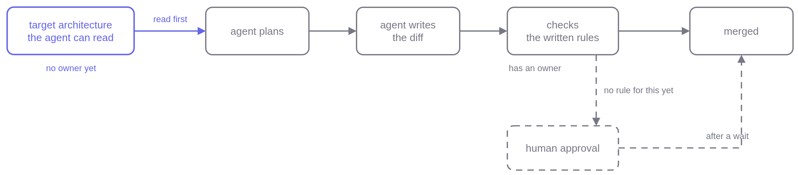

# Every Approval Is a Missing Rule

*If the architects do not write the rules the agents read, the person who writes the template does. Notes from reviewing an operating model for agentic delivery.*

Two weeks ago I got three documents to review. Together they describe how our company wants to build software when agents write most of the code: a vision, an operating model, and a tooling target. About twenty thousand words. (The chapter called "how do we get there" said Work In Progress. I have written that chapter myself, more than once, so no stones from me.) I read them over two evenings, with a pen, the way I read a design that is going to change my job.

On the second evening I went looking for the architect. The operating model has a role matrix. Product, design, engineering, quality, security, data. I read the table twice. There is no column for the architect. The word appears in the text, as a specialist you can "pull in on demand" for the risky changes. That was it.

I co-lead this transformation, so this is partly my own homework coming back marked. Treat what follows as notes from one review, with the author still a bit sore.

## A guardrail tells you which ditch you are in

The documents are good on one thing: control. Every change gets a risk class. Low-risk changes merge on their own, high-risk ones need a named human. Two independent validators check each change against the rules. Architecture shows up exactly there, as a rule a validator checks after the agent has written the code. Does the change cross a module boundary it should not? Fail. Does it call a database the service does not own? Fail.

That is a guardrail. It is useful. And it is half of the job.

Nothing in the three documents says where the estate should go. Our platform is more than twenty bounded contexts on an event-driven backbone, with a fifteen-year-old monolith still in the middle of it and stored procedures nobody fully reads. There are two legal ways to add most features to that estate. One keeps the monolith alive. The other moves a piece out. A validator cannot tell an agent which one we are trying to build towards, because the validator only knows what is forbidden. **A guardrail without a direction only tells you which ditch you are in.**

Birgitta Böckeler calls the two halves [guides and sensors](https://martinfowler.com/articles/exploring-gen-ai.html). A sensor looks at what the agent did. A guide tells the agent what to do before it starts. Our operating model has sensors. The guides have no owner.

## Who owns the contracts between teams

The matrix has no architect column because the documents merge the architect into the tech lead. One role, fewer boxes. I understand the appeal.

But **a tech lead owns one team. An architect owns the contracts between teams.** On our platform a typical feature touches five or six repositories owned by three teams. The screen belongs to one team, the API contract to another, the search index to a third. Nobody in that chain is wrong, and nobody in that chain owns the boundary between them. Merging the two roles deletes the only owner of the boundaries. I wrote about the orphan this creates in [Nobody Owns the Sum](/blog/nobody-owns-the-sum/), long before agents, and agents make it worse because they produce the parts faster.

The vision document has a line I like: "simplification over accumulation". I looked for who owns it. The comment thread under that line ended with the author promising to find someone. That is an honest answer. It is also the whole problem in one reply.

## The template author is your architect

Here is the part that changed how I spend my week.

When an agent writes the code, the design decision happens in whatever the agent reads first. The scaffold it copies. The skill file that tells it how we do a repository. The context file at the root of the repo. The example pull request somebody pinned in the team channel. If the architecture guild does not write those, somebody else does. Usually it is a helpful engineer on a Friday afternoon who only wanted the agent to stop making the same mistake, and by Monday several hundred developers have copied that file together with every opinion its author ever had about how a repository should look. **Whoever writes the template that everyone copies is the architect now**, whether they know it or not.

There is data on this already. ETH Zurich tested [repository context files](https://arxiv.org/abs/2602.11988) on 138 tasks earlier this year. Files written by a developer improved the agent's results by about 4%. Files generated by a model made them about 3% worse and cost 20% more to run. **The file helps when a person who knows the system wrote it, and only then.** So the file is architecture work. It just does not look like a diagram.

So the architect's output in an agentic model is a target the agent can read. Which contexts exist and which are being retired. Which contracts may change additively and which may not. Which events are public and which stay inside a context. Which paved road an agent should take for a new field or a new event. Put that where the agent reads it at planning time, before the diff exists, and the validator at the end has something to check against other than "forbidden".

I don't know yet how to scale the writing of those guides. A few architects for more than twenty contexts is the ratio we have. The guides need maintenance every time a model changes, and they rot faster than a Confluence page. That thread stays open.

## Count your approvals

The documents keep the architect for the risky changes, as an approval. I think the approval is the wrong place to spend an architect.

**Every approval I give is a rule I have not written yet.** The second time I approve the same kind of change, I know what the rule is. The third time, I am a queue. AI-written code already waits longest in review, as I found in [The Bottleneck Moved](/blog/the-bottleneck-moved/). An architect sitting in that queue makes it longer, for the wrong reason.

Zalando published [a snapshot of their agentic engineering](https://engineering.zalando.com/posts/2026/08/agentic-engineering-at-zalando-a-snapshot.html) in August. Their approval bot grades each pull request as low, medium or high risk on rules written from their own production incidents, very specific to their stack and their deployment files. A third of their pull requests merge with no human reviewer. A change that breaks backward compatibility still goes to a person. No model decides. The rules do, and the rules came from somebody writing down what used to be an approval.

I am not asking for more architect approvals. I am asking for architects to own the direction, the contracts and the rules, so that the checks can replace the approvals. An architect who still reviews routine changes is a sign that a rule is missing. For a month, log every approval you give and write next to it the rule it stood in for. Most of the rules repeat. Those go into a check. What is left is the job.

## Our own homework

Before I sent the review back, I checked what the architecture guild could point at. The numbers were worse than the documents.

Our context graph, the index over about 505 repositories that lets an agent read how the estate fits together before it touches any part of it, had 1,628 of its 1,650 commits from one person. One person. Of 38 repositories in my part of the company, 5 carry a context file. The curated standards repository, the one the guild "owns", held zero standards. Zero. "The guild owns the target" reads as a claim until a repository says so.

I stopped writing "the architecture guild owns" in documents that week. The sentence now starts with a commit.

There will be a next revision of the operating model. I would rather the architect column stayed empty than got filled with a name and nothing behind it. I know which file I am committing first ;)

---

**Scores:** tension=7 originality=6 personal=8 contrarian=7 substance=7 punch=7 trend=8
**Scored:** 2026-10-11 rubric=v1 model=claude-fable-5-1

**Tags:** Software Architecture, AI Transformation, Engineering Leadership, Organizational Design, Artificial Intelligence
