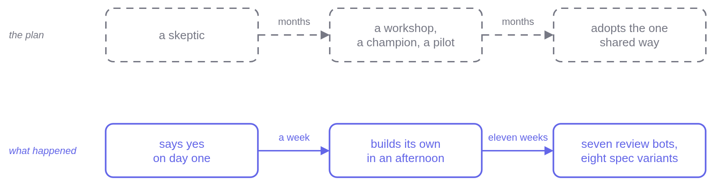

# Nobody Resisted

*We planned for skeptics and got 1,372 skill files in eleven weeks. Notes on an AI adoption that went too well.*

In spring I had a chapter ready for the skeptics. The workshop plan for our AI rollout had a section called "objections", with the lines I expected to hear from senior developers: I am faster by hand, it will leak our code, I tried it in 2023 and it was useless. I had an answer written down for each one and I never used any of them.

In the second week of July somebody ran a count over the repository index. We had 219 skill files in early May (the small instruction files an agent reads before it does a task) and 1,372 by late July. The context files at the root of each repo went from 75 to 496. Part of that jump is only the search index catching up, but the number still surprised me.

I co-lead this adoption across several hundred developers, so the mess I am counting below is partly my own.

## The problem I prepared for

Every transformation playbook I have read starts with resistance. You find champions and run pilots. You draw the curve with the early adopters on the left and the laggards on the right and plan the year around moving people along it. The numbers supported this. In the 2025 Stack Overflow survey [46% of developers said they distrust](https://survey.stackoverflow.co/2025/) the accuracy of AI tools, against 33% who trust it. Planning for distrust looked like the reasonable thing to do.

Our quarterly health check asks every team, among other things, how working with AI feels, on a scale from one to four. In June the average from 204 answers came back at 2.96. The lowest team was at 2.18, the highest at 3.62 and no team was anywhere near one.

So the wall I had prepared for was simply not there.

## What happened instead

We have an internal board where teams register their experiments. By the middle of summer it listed 405 proofs of concept and 89 marketplace plugins.

Take only the testing area. There were 69 tagged experiments there and the working group agreed to anchor 4 of them. About 60 of the others were the same idea, built again in a different team.

In the implementation area it looked similar. We had five pipelines that take a ticket through to a pull request, eight variants of spec-driven development and seven review bots.

Think about the seven review bots for a moment. Each one reads a pull request and leaves comments in its own tone, and none of them knows that the other six exist.

Nobody was blocking anything. Instead everybody was **forking** and my plan had no chapter about that.

## Conway's law at agent speed

Why does a team build its own review bot when six already exist? Because there was no place in the organization to share one, and because building it now costs an afternoon.

The second reason is new. Two years ago a review bot was a quarter of somebody's time, so before you built one you asked around, found the team that had already tried it, and usually ended up using theirs or dropping the idea. That asking around was our coordination. It was slow but it cost nothing extra. Now asking takes longer than building, so people skip it. As a result every team's agent setup ends up looking exactly like that team's boundaries. I wrote in [Multi-Agent Is an Org Chart](/blog/multi-agent-is-an-org-chart/) that an agent pipeline copies the organization that built it. In the skills folder you can see it directly: one directory per team.

So duplication used to be limited by effort and today nothing limits it.

There is a second problem hiding in the 1,372, and research from this year puts a number on it. [SkillsBench](https://arxiv.org/abs/2602.12670) tested 84 tasks across several agents in February. Skills written by a person raised the pass rate by about 16 points on average. Skills the model wrote for itself gave no gain at all, and in some setups made things worse. ETH Zurich found [the same pattern](https://arxiv.org/abs/2602.11988) for context files: the generated ones cost 20% more tokens for slightly worse results. Most of our 1,372 files were generated. If the research holds for us, most of them do nothing and a few do harm. Every agent still reads all of them on every task.

## Consolidate, not discover

Sixty days into the rollout we had a workshop to check where we are. The group looked at the same board and wrote down a verdict I did not expect in month two of anything: consolidate, not discover. In other words, stop looking for new things and choose from what we already have.

That is the opposite of what the innovation playbook says to do this early. It is also the first moment the transformation produced architecture, because consolidation is an architecture problem. Somebody has to decide which review bot is the shared one and where the domain knowledge lives, so that every team reads one copy. Somebody also has to write down which practices are banned because they already hurt a team.

The last part was done by our internal tech radar. I built it for this transformation, and it puts every practice into one of four rings, from Adopt to Hold. The Hold ring names harms we had seen: markdown files in repos treated as the company's knowledge base, oversized pull requests approved because the reviewer was tired, code committed to prove to a manager that AI was used. Nothing enters the Adopt ring unless two teams can show it in a repository. I described that rule in [From Signals to Blips](/blog/from-signals-to-blips/). In short: cite it or it did not happen.

What I got wrong at first was the order. I wanted to pick the standard in a meeting and then roll it out. What worked was the reverse: we watched which fork three teams had already copied on their own and made that one the shared one. So the official stamp comes after the thing has spread and not before. It is the same lesson as in [Adoption Is the Deliverable](/blog/adoption-is-the-deliverable/) and apparently I needed to learn it a second time.

## Count forks, not pull requests

There was one metric we refused from the start: pull requests per developer with an AI co-author. We asked leadership not to measure it, because that number goes up when people commit garbage to prove a point.

What I count instead is forks: for each capability, how many tools exist that do the same thing. Today that is seven review bots, eight spec variants and five ticket pipelines. **That number should go down.** When it reaches one, or two for good reasons, the organization has learned to share. As long as it goes up, we are still at the stage where building your own is cheaper than asking.

One caveat, because I have complained about [counting the wrong thing](/blog/data-driven-theater/) before. A falling fork count only says that the company learned to share. It says nothing about whether the shared bot is any good. For that we need a different measurement and to be honest I do not have it yet.

## The chapter I kept

The skeptic chapter is still in my drafts folder. I opened it last week, for the first time since spring, because the skeptics finally came. Only their question was no longer "why should I use this" but "which of the seven do we keep". It is a much better question and I had no prepared answer for it.

---

**Scores:** tension=7 originality=7 personal=8 contrarian=7 substance=7 punch=7 trend=8
**Scored:** 2026-10-11 rubric=v1 model=claude-fable-5-1
**Updated:** 2026-11-14 12:57

**Related:** multi-agent-is-an-org-chart, adoption-is-the-deliverable, from-signals-to-blips

**Tags:** AI Transformation, Organizational Design, Engineering Leadership, Artificial Intelligence, Systems Thinking
