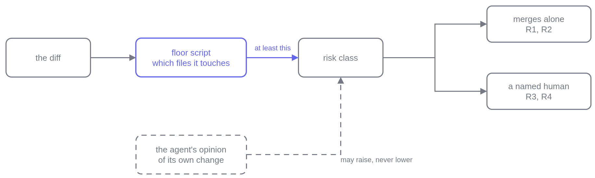

# The Model Grades Its Own Homework

*Sorting changes by risk is the right idea. Letting the agent's confidence set the class is the one input that turns every gate behind it into decoration.*

There is a sentence in the operating model draft I reviewed last month that I have read more times than any other. It sits in the chapter on risk classes: "For R1 and R2 with high confidence, the proposal stands."

I read it in the evening and I knew which change I was thinking about. A new field on a screen. The draft lists that as the example of a low-risk change. In our product that field was a stored procedure, a new column on an API contract that two other teams read, and a search index mapping. Three teams. On paper, R2.

This is one architect's reading of one draft, and the draft is still being revised, which is the whole point of reviewing it. Three weeks ago I wrote about [what the same documents leave out for architects](/blog/every-approval-is-a-missing-rule/). This one is about a single mechanism inside them, because I think it is the one that decides whether the rest works.

## The shape is right

The operating model sorts every change into a risk class, R1 to R4. R1 is a label typo: the agent merges it alone. R4 touches the scoring methodology or customer data: a named human signs it, and the agent has to explain the change back before anyone reads the diff. In between, the class decides how far the agent may go without a person. Two independent validators check each change against the written rules.

I like all of this. The classes give you a vocabulary for "how much do we trust this change", which most teams have never had. The problem is one line down, in who assigns the class.

## Who sets the class

The draft says the agent proposes its own class. If the class is low and the agent is confident, the proposal stands. In plain words: the agent decides whether a human looks at the agent's work.

Confidence is an output of the thing being gated. **A gate fed by its own subject is not a gate.** The tooling document in the same set says, in another chapter, that a model should not be the final authority on its own action. Both sentences cannot be true, and the drafts were written by careful people, so I read this as a seam between two chapters rather than a decision anyone made.

There is an older version of this idea that worked, and it is worth looking at why. Rouan Wilsenach published [Ship / Show / Ask](https://martinfowler.com/articles/ship-show-ask.html) on Martin Fowler's site in 2021. Every change gets one of three labels from its author. Ship: merge it, no review. Show: merge it now, open a pull request so people can look afterwards. Ask: wait for feedback. The author chooses, and it works because the author is a person who will sit in the same team next week, answer for the choice in the retro, and carry the name on the commit for as long as the repository exists. **The trust is in the person.**

Move the author to an agent and the person is gone. The choice has to move somewhere too. It cannot stay with the author.

## The R2 fiction

Even with an honest classifier, the examples in the draft do not survive contact with a real estate. On our platform a typical feature touches five or six repositories owned by three teams. "A new screen or field" crosses a stored procedure, a contract and an index, and each of those has somebody on the other side who will be surprised.

So one of two things happens. People classify down to keep moving, and R2 becomes the class that means "I did not want to wait". Or everything that is honestly R3 goes into the heavy path, the path with the specialist and the explain-back, and the queue I described in [The Bottleneck Moved](/blog/the-bottleneck-moved/) grows a new lane with the same three people at the front of it who were the bottleneck before anyone wrote a risk class down. Both outcomes kill the model. The first one kills it silently.

## A floor computed from the diff

What I proposed in the review is small. A list. Before any model is asked anything, a script reads the diff and computes a floor.

If a changed file is a stored procedure, the class is at least R3. If it is a published API contract, at least R3. A database schema, an event schema, a deployment manifest: R3 or above. The list is short. It is specific to our stack. Every line on it comes from an incident we have had. The agent may then raise the class, because it can see things a path rule cannot, such as a loop that now runs per customer instead of once. It may never lower it.

This is not a new idea. Zalando published [a snapshot](https://engineering.zalando.com/posts/2026/08/agentic-engineering-at-zalando-a-snapshot.html) of their agentic engineering in August, and the part I keep quoting is their approval bot. It grades each pull request low, medium or high on rules "highly specific to our tech stack, deployment manifests, configuration files", written from their own production incidents. Documentation is low. A change that breaks backward compatibility is medium and needs a human to check the business reason. A third of their pull requests merge with no reviewer, and lead time on those is 20 to 40% shorter than the average. **No model sets the class. Rules do.**

Even Meta, which runs an LLM reviewer at a scale nobody else has, wraps it in rules. Their [RADAR paper](https://arxiv.org/abs/2605.30208) describes a funnel: eligibility rules first, then a machine-learned risk score, then the LLM review, then deterministic validation before anything lands. About 60% of diffs get through, and the ones that do are reverted a third as often as the rest. The model is in the middle of the funnel. It is never the floor.

The obvious objection is fair: path rules match on file names, not on what the change means. True. That is why it is a floor and not the classifier. **The script decides the minimum.** The model, or a person, decides anything above it.

## Make the change safe, not the label

Here is where the risk classes stop being a control mechanism and start being an architecture roadmap.

The honest way to get more changes into R2 is to make more changes safe, and trunk-based development solved this problem a decade ago without any classifier at all. You do not ask whether a change deserves a human gate. You make every change small and backward compatible, and the pipeline is the gate. Danilo Sato wrote down the recipe for the compatible part in 2014 as [Parallel Change](https://www.martinfowler.com/bliki/ParallelChange.html): expand the contract, migrate the consumers, contract the old shape. A paved road that does this for a new field, with a contract test and a schema compatibility check in CI, lets the floor script say R2 and be telling the truth.

Zalando noticed a side effect of their bot that I think is the whole point. Engineers started shaping pull requests so they would qualify as low risk. Smaller changes, additive changes, compatible changes. Somebody will call that gaming. I call it the first time a governance rule made people do what trunk-based development had been asking them to do for ten years ;)

The gaming worry is still worth answering. An agent that learns schema changes block auto-merge may split one logical change into two diffs. Fine. The schema file is still in one of them, and the floor still trips. If the agent splits a change into two safe, compatible steps instead, that is not gaming. That is the paved road working.

## Try it on your last twenty

The floor I proposed for our stack is mostly a list of file patterns. Yours will be different, and that is the point: the patterns are where your incidents live.

Take your last twenty merged pull requests. For each one, write down the class the author gave it, or would have, and the class the files alone would give it. Count the gap. If I had to guess, a third of your R2s are R3 by the files. I would like to know if I am wrong, so send me the two numbers.

---

**Scores:** tension=7 originality=6 personal=7 contrarian=7 substance=8 punch=7 trend=8
**Scored:** 2026-10-11 rubric=v1 model=claude-fable-5-1

**Tags:** Software Architecture, AI Transformation, Artificial Intelligence, Engineering Leadership, Decision Making
