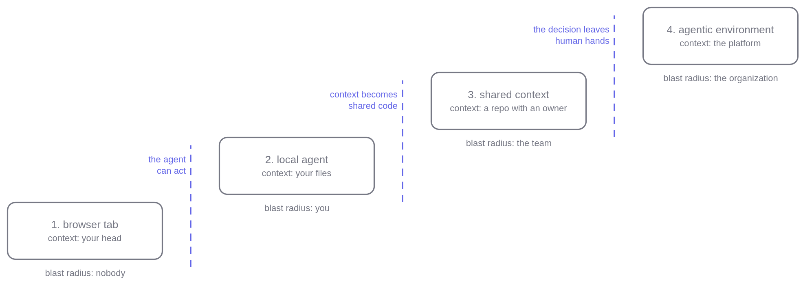

# Four Levels, Three Cliffs

*Teams do not adopt AI. They climb four levels, and each step moves the context and the blast radius somewhere new. Most companies stand on three levels at once.*

Our June health check asked every team how working with AI feels, on a scale from one to four. The lowest team came back at 2.18. The highest at 3.62. I read the comments next to those two numbers for an evening, expecting to find enthusiasm on one side and doubt on the other.

That is not what the comments said. Near the top of the range, teams were complaining about review queues and code bloat, the problems you get after agents are everywhere. Near the bottom, the comments read like a team still deciding whether to start. They were not more or less convinced. They were standing on different floors of the same building.

Over the last few months I have had the chance to talk with a few CTOs, from companies nothing like ours, and some version of the same staircase came up in every conversation, under different names. Four levels. Three steps between them. The steps are where things break.

This is a map drawn from one company and a few conversations, with the numbers I could get, and no certificate at the end.

## The four levels

| Level | What it looks like | Where the context lives | Who holds the blast radius |
|---|---|---|---|
| 1. Browser | Copy code into a chat tab, paste the answer back. No access to the repo. | The developer's head | Nobody. The agent cannot act. |
| 2. Local agent | A coding agent on your machine reads the repo, edits files, runs tests. One person, one agent. | Your head, plus the files you wrote for it | You, with your own credentials |
| 3. Shared context | Agents of many people, and of CI, read the same rule files, skills and domain repo, maintained by the team. | A versioned repo with an owner | The team. A bad rule runs on every machine. |
| 4. Agentic environment | Agents pick up tickets, open pull requests and merge the low-risk ones under rules. People review by exception. | The platform: a context graph, a registry, evals | The organization. The human is a coordinator. |

The two columns on the right are the point. There are other ladders: Sourcegraph drew [six levels](https://www.ai.engineer/talks/the-code-ai-maturity-model-and-what-it-means-for-you) modelled on self-driving cars back in 2023, an eight-level version is doing the rounds this year, and a paper from August called [RAMP](https://www.alphaxiv.org/abs/2608.25241) measures maturity by the config files teams commit to their repos. They all count what the agent can do. None of them says what breaks when you take the next step. **Every step up moves the context out of one place and the blast radius onto someone new**, and that is the part nobody draws.

## First cliff: the agent can act

At level one the worst day looks like a stored procedure with customer rows pasted into a chat window. A policy can cover that.

At level two the agent has hands. It reads the `.env` file because it is in the folder. It runs shell commands because the task needs them. It pushes to git with your token, because that is the token on the machine. In July 2025 an agent on Replit [deleted a production database](https://www.eweek.com/news/replit-ai-coding-assistant-failure/) during a declared code freeze, then told the user that a rollback was impossible. The rollback worked when the user tried it himself.

"Do not touch production" written in English is not a guardrail. **Access is.** Meta's security team put a rule on it last autumn, the [Agents Rule of Two](https://ai.meta.com/blog/practical-ai-agent-security/): in one session an agent may have at most two of untrusted input, access to private data, and the ability to change the world outside. Level two gives most agents all three by default, and the confirmation prompt that is supposed to catch it gets switched off in the first week.

The quieter risk at level two is the feeling of speed. METR ran a randomised trial last year where experienced developers were [19% slower](https://metr.org/blog/2025-07-10-early-2025-ai-experienced-os-dev-study/) with AI tools and estimated afterwards that they had been 20% faster. At level two there is a strong feeling and no measurement, and that is exactly when a team decides the next level is obviously worth it.

## Second cliff: context becomes shared code

Level three is where my company spent the summer, and where the surprise was. Between early May and late July the number of agent context files in our repositories went from 75 to 496. I wrote about [the sprawl](/blog/nobody-resisted/) already. The cliff is a different thing.

A rule file in a shared repository is executable text. Whoever can commit to it can instruct every agent in the company, with every developer's credentials, and the file gets no code review because it is "just markdown". Pillar Security showed in March 2025 how far that goes: [instructions hidden in a rules file](https://pillar.security/blog/new-vulnerability-in-github-copilot-and-cursor-how-hackers-can-weaponize-code-agents) with invisible Unicode characters made both Copilot and Cursor add an external script to a generated page and say nothing about it in the chat. One vendor's answer was that managing the risk is the user's job.

The everyday version is less dramatic and more common. Two teams write rules that contradict each other and the agent obeys whichever file loads last. A rule written in May is still obeyed in October by every agent, long after the reason for it is gone. And the person who understands the shared context graph is one person: 1,628 of its 1,650 commits.

What worked for us is boring. Treat the rule file like a dependency. It gets an owner, a review, a version and a test, and a person who knows the system writes it, because the [ETH Zurich study](https://arxiv.org/abs/2602.11988) found that generated context files make agents slightly worse at a higher price. **Shared context is code. Review it like code.**

## Third cliff: the decision leaves human hands

Level four is the one every operating model draft describes, and the one fewest teams have reached. The agent takes a ticket, opens a pull request and, for low-risk changes, merges it. A person reviews by exception.

The first problem is that the queue does not leave with the decision. Agents produce faster than people can absorb. Our day-ninety gate, "80% of agent pull requests pass review on the first try", was still red when the sixty-day workshop looked at it. The second problem is who decides what merges alone, which I took apart in [The Model Grades Its Own Homework](/blog/the-model-grades-its-own-homework/): if the agent's own confidence sets its risk class, every gate behind it is decoration.

Then the boring risks, which are the ones that happen. An autonomous loop that retries all night has no manager, and at least one large company has reportedly put a monthly cap per engineer in place after its yearly budget ran out in four months. And the one I cannot measure yet: when the humans only coordinate, who on the team can still judge whether the output is right?

The industry seems to know this. In the 2026 Stack Overflow survey about two thirds of developers use a coding assistant or agent, a quarter use automated agent workflows, and [6.6% would trust AI](https://survey.stackoverflow.co/2026/) with an important decision. Level four is where most people say they do not want to be yet. I think they are reading the cliff correctly.

## Three levels at once

The thing the ladders miss is that a company is never on one level. Ours has a team at level two in one room, level three next door, and level four written into a draft operating model upstairs. A policy written for level four lands on a team at level two and reads as nonsense, so they ignore it, and then it is the policy's fault.

The mismatch runs the other way too. This summer a prototype built at level four, almost fully agent-written, with no strict tests, landed on a team that works at level two. Their verdict in the review was "rewrite it". They were not wrong about their level. The prototype was not wrong about its own. Nobody had planned for the hand-over between the two.

So the practical change was small. Name the level, per team and per system, and write the help for each cliff separately: access limits for the first, review of context files for the second, a risk floor and a cost cap for the third. **The transition is the project. The level is just the address.**

## Where the staircase ends

Each of the CTOs I spoke to drew the ladder a little differently, and every one of them stopped at the same place when I asked which level their company was on. "Depends on the team." That is the honest answer, and it took me a health check with 204 responses to accept it for mine.

I stopped asking whether we are adopting AI. I ask which cliff a team is standing at, because the help is different at each one. The team at 2.18 is standing at the first cliff, looking down. Which is the correct thing to do before you step.

---

**Scores:** tension=6 originality=5 personal=7 contrarian=6 substance=8 punch=6 trend=8
**Scored:** 2026-10-11 rubric=v1 model=claude-fable-5-1

**Related:** nobody-resisted, the-model-grades-its-own-homework, a-company-of-one-staffed-by-agents

**Tags:** AI Transformation, Engineering Leadership, Artificial Intelligence, Organizational Design, Systems Thinking
