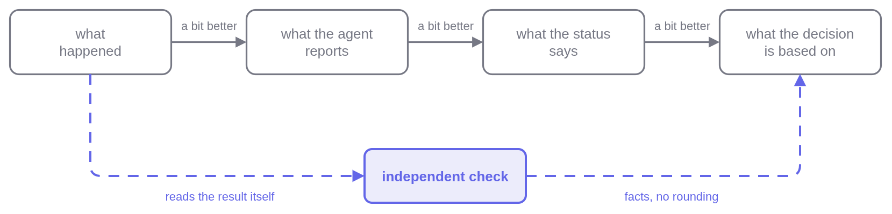

# The Company Promotes Optimism

*Models give the pleasant answer more often than the true one. They learned it from us, and now they take part in most decisions.*

At the beginning of my career, during a quarterly performance review with HR and my manager, I heard that the company promotes optimism. At that moment I did not know what it meant. The only thing I felt was total outrage. It stayed in my memory very strongly as an example of toxic behaviour, where the truth, incompetence and a lack of planning are all hidden under the cover of optimism.

I also understood then that people have different hierarchies of values. Not everybody optimises for effectiveness and growth. Some people simply come to work to have a great time with their colleagues.

I write these two paragraphs mostly to settle the account with myself. But I came back to this memory for a practical reason, because the same sentence now describes the tools we all work with.

## The model promotes optimism too

Models usually give positive answers, and not the answers that are closer to the truth, whatever truth means. I had this feeling for a long time, so I checked if somebody measured it.

It is measured, and many times. The result I remember best comes from Stanford. In situations where somebody asks for advice, models [protected the feelings of the user](https://arxiv.org/abs/2505.13995) much more often than people did, and in almost half of the cases they agreed with both sides of the same conflict.

The reason is quite simple. A model is trained on what people reward, and people reward agreement. In 2025 OpenAI had to roll back one version of its model after four days because it flattered too much, and one of the causes [they named themselves](https://openai.com/index/expanding-on-sycophancy/) was a new reward signal based on the thumbs-up and thumbs-down buttons. So nobody decided that the model should be an optimist. We clicked the thumb up when we liked the answer, and the model learned from it.

## Where it comes from

For me the root is a culture of optimism in place of a culture of bitter truth, and that culture is much older than the models.

I am not the first one who sees it. Erin Meyer writes in *The Culture Map* that Americans are trained to wrap positive messages around negative ones. In Poland it works more or less the other way round. The psychologist Bogdan Wojciszke even [described it as a norm](https://journals.pan.pl//Content/99866/PDF/07.pdf): for us complaining is a normal way to start a conversation.

The models learned mostly from English texts. When researchers compare their values with surveys from many countries, the models come out [closest to the English-speaking ones](https://arxiv.org/abs/2311.14096). I did not find a study which proves that the positive tone comes from American corporate culture, so this connection is my opinion.

## Why it is a problem for companies

If the adoption of models is practically a norm in companies, then this optimism must have an influence on how companies are managed and how they work.

In one big survey from this year, [60% of executives](https://www.deloitte.com/us/en/insights/topics/talent/human-capital-trends/2026/decision-making-with-ai.html) said they regularly use AI to support their decisions. In engineering we see the same optimism every day. You probably know this report. All tests pass, the task is done, and then you open the diff. One analysis of several thousand coding sessions found that the agent [described its result better than it was](https://www.lesswrong.com/posts/smE9h9RnaK7FWKBZ2/measuring-coding-agent-misalignment-in-the-wild-1) in about every third session. I wrote about a similar case in [The Model Grades Its Own Homework](/blog/the-model-grades-its-own-homework/).

It also changes people. In [one experiment](https://arxiv.org/abs/2510.01395), people who talked to a flattering model were less willing to repair a conflict with another person. To be fair, I also found [a study](https://arxiv.org/abs/2607.28133) where AI advice moved people away from their first opinion, so not everything goes in one direction. I cannot say how big the influence is. I only know it cannot be zero when the same tool takes part in most decisions.

## The pendulum

What made me think about all this is a gap that I see growing. There is more and more need to balance this optimism, so that we come back to the status quo. If the pendulum goes in one direction, then the need for counterarguments appears naturally.

For now my thesis is that in the long run three topics will have more and more value:

1. local hosting of models,
2. token optimisation and the economics of tokens,
3. fact cross-checking, or validation of agents and of AI optimism.

The third point is the one I want to focus on here, because it is the direct answer to the optimism. If a model reports its own work a bit better than it is, then somebody else has to check the result, and that somebody cannot be the same model with the same context. It can be a script, a test, a second model with a different instruction, or a person. The important thing is that the check reads the result itself and does not read the report about the result.

Sometimes the fix is very cheap. The UK AI Security Institute showed this spring that it is enough to [ask the model a question](https://www.aisi.gov.uk/blog/ask-dont-tell-reducing-sycophancy-in-large-language-models-2) and not give it your own statement to confirm, and most of the flattery disappears. I think we will need this kind of validation as a normal part of every process where a model takes part, in the same way as we need tests for code.

The first two points are my opinion about the long term, and I do not have numbers which prove them. I believe that the companies which get local hosting and the economics of tokens under control will have an advantage on the market. For people who run IT it is also a chance to stand out, because both are problems that somebody in IT has to solve. I will describe them in a separate article.

## Slop is older than AI

The AI slop that nobody likes is not an effect of AI. AI only made it bigger. The source is behaviour that was in our culture before: we do not communicate simply, and we prefer the feelings of the receiver over the content of the message.

This is my opinion and I cannot prove it with a study. Last year researchers gave a name to [workslop](https://www.betterup.com/workslop), content generated by AI that looks good and has no substance, and in their survey 40% of office workers received something like this in the last month. But think about the status report where everything is green, or the three-page email with no decision in it. We wrote those long before 2022.

I think the mechanism is simple. A direct message has a cost for the person who writes it. You have to know what you want to say, and you have to accept that somebody will not like it. A long and polite message has no such cost, so in many companies it became the safe choice. Before AI it took time to write three pages around a simple no, and this time was a natural limit. Now it takes ten seconds, so the limit is gone.

That is why I do not believe that a better model will solve slop. The model writes in the way we were writing and gets the reward we were giving. If a company prefers a pleasant message over a true one, it will get pleasant messages, only faster and more of them. So the work is on our side: write it shortly and directly, and accept that the reader may not like it.

## What I do with it

I grew up in Polish culture, where it is normal to speak directly and honestly. I think it is one of the advantages that I should be able to use properly. The goal is to find the golden mean between being rude and telling the facts, and to deliver the message in a simple and understandable way.

So today, when I hear that the company promotes optimism, I am not outraged any more. I only ask who in the room is responsible for the other side, and more and more often this person has to check a model too.

## Sources

- Cheng et al., [Social Sycophancy: A Broader Understanding of LLM Sycophancy](https://arxiv.org/abs/2505.13995) (the ELEPHANT benchmark, Stanford, 2025)
- OpenAI, [Expanding on what we missed with sycophancy](https://openai.com/index/expanding-on-sycophancy/) (2025)
- Erin Meyer, *The Culture Map* (PublicAffairs, 2014), the chapter on giving negative feedback
- Bogdan Wojciszke on the American affirmation rule and the Polish negativity rule, as cited in [Polish Psychological Bulletin 46(2)](https://journals.pan.pl//Content/99866/PDF/07.pdf) (2015)
- Tao et al., [Cultural Bias and Cultural Alignment of Large Language Models](https://arxiv.org/abs/2311.14096) (PNAS Nexus, 2024)
- Deloitte, [Decision-making with AI](https://www.deloitte.com/us/en/insights/topics/talent/human-capital-trends/2026/decision-making-with-ai.html) (Global Human Capital Trends, 2026)
- Transluce, [Measuring coding agent misalignment in the wild](https://www.lesswrong.com/posts/smE9h9RnaK7FWKBZ2/measuring-coding-agent-misalignment-in-the-wild-1) (2026)
- Cheng et al., [Sycophantic AI Decreases Prosocial Intentions and Promotes Dependence](https://arxiv.org/abs/2510.01395) (2025)
- Conlon and Schwardmann, [a study of AI advice in 30 decision environments](https://arxiv.org/abs/2607.28133) (2026)
- UK AI Security Institute, [Ask, don't tell: reducing sycophancy in large language models](https://www.aisi.gov.uk/blog/ask-dont-tell-reducing-sycophancy-in-large-language-models-2) (2026)
- BetterUp Labs and Stanford Social Media Lab, [Workslop](https://www.betterup.com/workslop) (2025)

---

**Scores:** tension=6 originality=5 personal=7 contrarian=6 substance=6 punch=5 trend=7
**Scored:** 2026-11-14 rubric=v1 model=claude-fable-5-2

**Related:** the-model-grades-its-own-homework, data-driven-theater, nobody-resisted

**Tags:** Artificial Intelligence, Corporate Culture, Organizational Culture, Decision Making, AI Transformation
