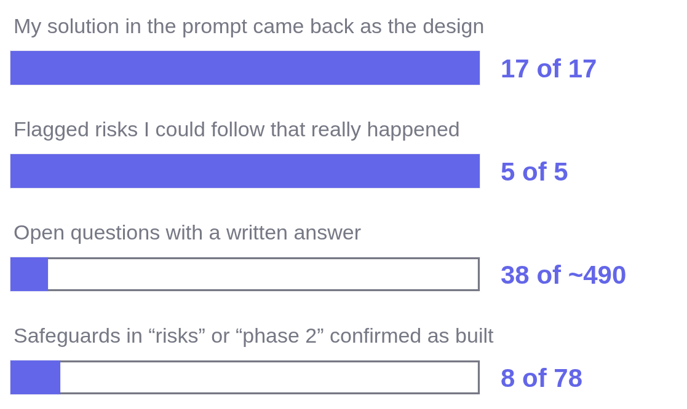

# One Step More Certain

*I checked nine months of my architecture documents for AI optimism. The optimism came from my prompts and our plans. The model made it sound certain.*

Last week I wrote that [models promote optimism](/blog/the-company-promotes-optimism/): they give the pleasant answer more often than the true one, and many studies confirm it. After I published it, one question did not leave me alone. If this is true, I should see it in my own work. Since March a model has written the first draft of almost every architecture document I made.

I am a solution architect in a global SaaS platform, and my job is mostly writing. Before several squads build something together, somebody has to write down how the parts will fit. So I write solution designs, decision records (one page per decision: the options we had and why we chose one) and lists of open questions for the product team. For each of them I give a model the requirements and the code, I write a prompt and I correct the draft. I keep every prompt next to its result, so nine months later I could check all of it. I described the setup in [Prompt-Driven Architecture](/blog/prompt-driven-architecture/).

I will give the result first. I did not find an optimistic model. I found a model that takes what I give it and returns it **one step more certain**. My opinion comes back as a decision, and a plan comes back as a fact. The optimism was already in the input: in my own prompts and in the plans of the company. The doubts were in the documents too, but usually on the last page, and most of them never got a written answer.

By "more certain" I mean the status of a statement. Every sentence in an architecture document has one, even when nobody writes it down. In practice it is a ladder with five levels:

opinion → proposal → decision → built → checked in production

The team reads the status to know what to do next. While a sentence is a proposal, people discuss it and somebody owns it. When it becomes a decision, the squads build it and nobody asks about it again. So when a sentence goes one level up without a reason, the questions about it stop.

In numbers, this is what I found:

- In 16 cases a statement went at least one level up when a model copied it into a new document, and I found no decision in between.
- In 17 of 17 prompts where I wrote my own solution or a hard constraint into the question, it came back as the design.
- Of about 490 open questions in our question lists, only 38 have a written answer anywhere.

## What I checked

The folder has 308 text documents from March to November. A model drafted 220 of them from one of my 36 saved prompts. For every document I asked two questions. What did it claim? And what do we know today from a later document, from the code or from production? It was too much to read by hand, so a model did the reading in four separate passes, without knowing what I expected. Still, a model counted everything below, and this is the weak point of the review. I come back to it at the end.

I expected optimistic language, but there is almost none: the phrase "quick win" appears in 2 of the 220 drafts. Read alone, each document looks careful.

## How a statement moves up

The problem shows up only when you follow one statement from document to document. Here is the clearest of the sixteen cases, one recommendation about how to model the relationship between two companies on our platform:

| When | Document | What it said about the recommendation |
|---|---|---|
| May | Decision document | "Status: Open / Needs Further Discussion" |
| A week later | Solution design, drafted with a model | Listed under "Confirmed decisions" |
| Three weeks later | Questions for the product team | Listed under "Already decided, please don't reopen" |
| End of July | New solution design | It "was never ratified", so in fact nobody had decided it |

The text of the recommendation stayed the same in all four documents. Its status went from open to decided while it was copied from one document to the next, and in the end we built something different.

Other examples are a bit embarrassing. For an AI assistant for our customers, the model drafted fifteen decision records in one day. All fifteen were marked "Accepted" on the day they were written, before anybody except me had read them. Four months later about six were reversed or dropped. In another proposal I added a confidence field to every example file, with four values to choose from. The model chose "Fact" in 19 of 30 files, and 9 of those described something that did not exist yet.

This is not only my folder. When ten models summarised scientific papers, their summaries were [nearly five times more likely](https://www.ncbi.nlm.nih.gov/pmc/articles/PMC12042776/) to contain broad generalisations than summaries written by people. They lost qualifiers like "in this group" or "probably" first. In a design document, a lost "probably" is exactly how "proposed" becomes "accepted".

## It works with bad news too

In March a model read only our documents, without the code, and made a list of twelve gaps with the label "delivery cannot proceed without resolution". We delivered in May, and none of the twelve stopped us. This changed my thesis. The model was as sure about bad news as about good news, so "optimism" is the wrong word. Whether the answer sounds good or bad depends on what the model gets and what it is asked, and the model adds only the certainty. In a company most of the input is plans, and plans are optimistic, so the output looks optimistic.

## The optimism came from my prompts

So who brings the optimism? This part was not pleasant to read, because the answer is me.

In 17 of my 36 saved prompts I had written my own solution or a hard constraint into the question, and every time it came back. Once I wrote in a prompt, word for word, "in my opinion that make sense". The model agreed with me. It had one objection, and it put it as number 3 in the list of open decisions. Then I prepared a Slack reply from this design, and the objection was not in it at all.

The model did push back, but always against somebody else, for example against a product document or an old diagram. It never questioned the assumption in my prompt. I also had prompts where I asked openly, like "give me two or three options and I will choose". In all 5 of them the answer went against an opinion that I had already given somewhere else. So the model is able to disagree with me. It just did not do it when my opinion was already in the prompt.

Researchers at the UK AI Security Institute showed this spring that most of this agreement goes away when you [ask the model a question](https://www.aisi.gov.uk/blog/ask-dont-tell-reducing-sycophancy-in-large-language-models-2) instead of giving it your opinion. My prompts from July, a few months later, still started with my opinion.

## The risks were on the last page

On average the first section about risks or open questions starts after about three quarters of a design. Partly this is our own fault. The solution design template in our company has twelve sections and none of them is for risks. So the model adds the risk section where it always goes, at the end. A reader with ten minutes reads the summary and the diagram and never gets there.

You can see the cost in the July design of the AI assistant. The first delivery was planned for the turn of Q3 and Q4. The risk table started 93% of the way into the file, and two risks in it had high impact and high probability: the frontend platform was not ready, and there were no people to build it. In November the project was on hold, for exactly these two reasons. I could follow five flagged risks from a design to the end of the project, and all five happened. Five is a small number, but it is enough to show that the risks were known.

The safeguards were written down too. In the designs 78 of them (a monitoring job or a load test, for example) ended up in the risk section or in "phase 2". I can confirm that 8 were built. For the other 70 I found no proof, but some of them may exist without a trace in the documents.

## What corrected a design

In nine months I found only three things that corrected a design: reading the code, running a test, and a written answer from a person. I did not find a case where another document did it.

The best example is one test. In July a decision record for the AI assistant said that no model writes SQL queries. In November the rule was relaxed in the new design, with a note that nobody had objected. Then a colleague tried it, and the generated query returned a company from outside the buyer's own network, so data this buyer should not see. Three days later the rule was back in the design: no model writes SQL for buyers.

## What I do now

Since then I work with three rules.

1. Only a person or the running code can move a sentence up the ladder. The model may copy a status from the source but it may not raise it. "Accepted" on a decision record now needs the name of the person who accepted it.
2. I ask before I tell. When I have an opinion, I put it into the prompt as a hypothesis and ask the model to attack it.
3. Risks go to the top of the document, and each one gets an owner and a date.

Now back to the weak point from the start. A model did the counting, so by my own ladder these numbers are still proposals. I will check the 17 prompts and the 78 safeguards by hand, and if the numbers move, I will correct them here.

And there is one result I cannot explain yet. My documents from autumn look more careful than the ones from spring. I do not know if I learned something or if the models changed ;)

## Sources

- Peters and Chin-Yee, [Generalization bias in large language model summarization of scientific research](https://www.ncbi.nlm.nih.gov/pmc/articles/PMC12042776/) (Royal Society Open Science, 2025)
- UK AI Security Institute, [Ask, don't tell: reducing sycophancy in large language models](https://www.aisi.gov.uk/blog/ask-dont-tell-reducing-sycophancy-in-large-language-models-2) (2026)

---

**Updated:** 2026-11-23 11:30

**Scores:** tension=7 originality=6 personal=8 contrarian=7 substance=8 punch=6 trend=8
**Scored:** 2026-11-23 rubric=v1 model=claude-opus-5-5

**Related:** the-company-promotes-optimism, prompt-driven-architecture, the-model-grades-its-own-homework

**Tags:** Software Architecture, Artificial Intelligence, AI Transformation, Decision Making, Engineering Leadership
