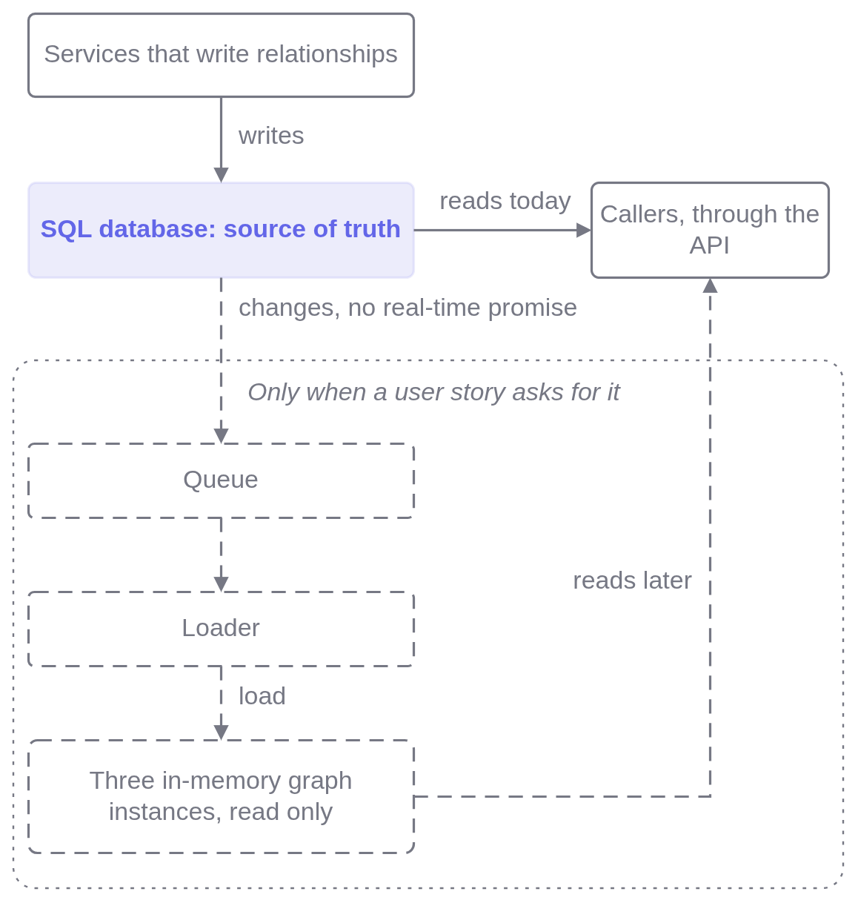

# The Graph Database We Didn't Buy

*We measured graph databases against plain SQL tables on tens of millions of relationships. For our questions the table won, and it still does.*

A plain SQL table found the first page of companies seven relationships away from a given company in 45 milliseconds. The graph extension of the same database did not answer the same question at all. At least not in the time we were ready to wait.

That was in 2023. We were preparing the first version of a service for the relationships between companies. The goal was one source of truth for the question "who is connected to this company?" for all the other services. I was the architect of that service. Relationships between companies are a graph, so the obvious question was which graph database to use.

We did not choose one. We ran a proof of concept and measured graph databases against plain tables. We estimated the price of the fastest engine. Then we decided to keep the relationships in SQL and to add a graph engine later as a read layer, when we need it. Later never came. Two and a half years on, the service runs in production on SQL without a graph database. I think the second half of the story is the more useful one, but it only makes sense after the numbers.

## What we ask a graph

Before the engines, the questions. The proof of concept tested the reads we expected the service to answer:

- the neighbours of one company, one page at a time;
- the same, sorted by the neighbour's name;
- particular neighbours: is this company connected to these ones;
- the neighbours of the neighbours, a few levels down.

And the writes. We create companies and relationships in batches. We merge two companies when we find out that they are the same one. And we delete a company together with all its relationships.

One thing makes all of these harder, and that is hubs. Think of a public register of company ownership: most companies have a few relationships and a large holding has hundreds of subsidiaries. In our test data the large company had about ninety times more relationships than the small one. A query that is fast for the small one can be slow for the large one, so every read ran on both.

## The test

The data set had millions of companies and tens of millions of relationships of one type. A second type was much smaller. All numbers below are approximate typical times, the way we wrote them in the sheet. The candidates were:

- Azure SQL Database (serverless, 8 vCores) with plain tables: companies, relationships with a source and a target, and a few non-clustered indexes.
- The same engine with its graph extension. You declare node tables and edge tables and query them with `MATCH`. It ran on 16 vCores.
- An in-memory graph database, which keeps the whole graph in RAM. We loaded it with about a sixth of the relationships.
- Two disk-based graph databases that store the graph on disk like most databases do. One of them ran on virtual machines in five configurations.

Next to the timings we kept a paper comparison of five candidates, not exactly the same set. It asked about a managed service in our region, one cluster for several environments, a Kubernetes operator, merging and splitting nodes and the .NET connector.

## What came back

Each cell is the small company / the large company, for a page of twenty:

| Question | Plain tables + indexes | Graph extension, same engine | In-memory graph database | Disk-based graph database A | Disk-based graph database B |
|---|---|---|---|---|---|
| Neighbours | 30 / 35 ms | 30 / 80 ms | 0.5 / 1 ms | 0.6 / 6 s | 11–13.5 s |
| Particular neighbours | 35 / 35 ms | 100 / 80 ms | 0.3 / 0.3 ms | 0.7 / 6 s | 12–13.6 s |
| Second level | 45 / 45 ms (large: 4th level) | too long to wait | 3 / 500 ms | not measured | not measured |
| Seventh level | 45 / 45 ms (large: 4th level) | too long to wait | 2 / 3 ms | not measured | not measured |

The in-memory engine's 500 ms was a sorted query with a missing index, and its 3 ms had a filter. Database B ran a slightly different test on five machine configurations, so it has one range per row.

So, four things.

The plain tables were enough. A page of neighbours took 30 to 55 ms, for a page of twenty or of two thousand. A few levels down took 45 ms. Even an eleventh-level query with a filter on a property without an index came back in 600 ms for the small company. For a service that answers other services that is fine.

The graph extension of the same engine was slower than plain tables on twice the cores. One hop was in the same range, but two to three times slower in most cells. For the multi-level queries we stopped waiting. This result surprised us most, because intuition says the opposite: you have graph data and the database has a graph feature, so you use the graph feature. Maybe a different form of the query would finish. So I would not publish this as a verdict on the engine, only on our queries. For those, a join on a good index beat the feature that was made for them.

The in-memory graph database was faster than everything else by one to two orders of magnitude. But in the sheet it has about a sixth of the relationships, all of them in memory. So the honest comparison is "much faster on less data".

The disk-based graph databases took seconds. Database B returned related companies in 11 to 13.5 seconds on every machine we tried. We went from 4 to 8 vCPUs and from 16 to 32 GB of memory and the time almost did not move, so the hardware was not the problem. On a cluster, one page of a hundred relationships of a hub took 20 seconds. Database A was faster: 0.6 seconds for the small company and 6 for the large one. But we were still clarifying those numbers with the vendor. Our test project and the vendor's web interface gave very different times, and we suspected our driver and the network as much as the engine.

## Why a table can be enough

The promise of a graph database is that a relationship is a pointer. To go from a company to its neighbours the engine follows pointers and does not search an index. A table has to search. It finds the first row for the company in an index on the source column and then reads the rows next to it. But even with tens of millions of rows that index is only three or four levels deep, and the upper levels stay in memory anyway. A page of twenty neighbours is one search plus twenty rows that lie next to each other. So for one hop the index costs a few extra page reads. The in-memory engine was still much faster on one hop, but 30 ms was already fast enough for us. The cost of searching grows with depth, because every level is a new round of searches. Most of our questions were one hop, and the deep ones in our tests asked for one page.

## What the timings did not show

The paper comparison was as useful as the timings. One engine needed a separate licence for every environment. It had no Kubernetes operator, so every data migration would be manual, and its documentation for self-hosting was weak. Another had poor documentation for its .NET connector, and one had no .NET connector at all, only a REST API.

One row in that sheet is about merging. When two company records turn out to be the same company you merge them, and sometimes later you split them again. Only one of the five candidates could do both natively. Next to one of the others the sheet says: manual algorithm needed, the same algorithm as with a relational database. So for the hardest write we had, a graph database would only move the effort to a new engine.

## What a month costs

We estimated the price of the in-memory engine as a managed cloud service. We fed the vendor's storage calculator with the same smaller data set as the test, and it pointed to an instance with 32 GB of memory and 8 CPUs. We added a buffer of one and a half on top, for production and for a lab environment.

Compared with the monthly bill of our two proof-of-concept SQL databases, the graph cluster was five to fifteen times more per month. It depends on how you count the environments and the buffer. That is not a fair comparison in either direction: on one side two serverless test databases, on the other a production estimate sized for a sixth of the relationships. (Even the test databases went over their monthly budget in the second week of January, which tells you how small that budget was.)

But the ratio was not the main point. The graph cluster would not replace anything. SQL stays the source of truth for the writes and the transactions. So the graph engine is an extra line on the bill every month, on top of the database we already pay for.

## The decision

In the end we went with SQL Server (in our case Azure SQL) because of price, performance, scaling and the use case. Price, because it was cheaper than a graph cluster. Performance, because the tables with indexes answered in tens of milliseconds. Scaling, because the plan was to scale writes in SQL and one day reads in a graph engine. And the use case, because our questions were mostly one hop and paged, with a few levels down from time to time.

The idea at that time was simple: storage in SQL, and later the in-memory graph engine as the query layer. The blueprint of the service has one line about it, in the notes from a meeting in April 2024: the first version does not need a graph database, and read optimisation in the future will include the in-memory engine.

The plan for later is in the notes of the proof of concept. SQL takes all the updates and there is no real-time promise for the graph side. Changes go through a queue to a loader, and the loader feeds three in-memory graph instances that serve only reads. The source of the changes was still on the list to check: the database's change feed or an event service. So the graph would only be a projection. If it is wrong or down, we rebuild it from SQL.

This is the decision I would defend today. A plan with a later stage is only honest when the first stage can stand alone, and I wrote about that in [Design the Stopping Point](/blog/design-the-stopping-point/). Our first stage could stand alone. The callers only see the service's API, so a graph engine could be added behind it and no caller would know.

## Why later never came

The short answer: there was no user story at that moment which really needed graph capability. And the multi-level queries could be done with indexes, which worked fast on the database.

The proof of concept had predicted that. The seventh level in 45 ms was in the sheet about nine months before the first database migration of the service. And in two and a half years of production the problems we had were about indexes and the shape of a row, not about traversal. An index was missing for the other direction. We had to decide what the identity of a relationship is, what happens when you overwrite it and which message comes first. That is the [next post](/blog/one-row-per-edge/).

So the decision "graph later, after measurement" worked, because the measurement never said "now". I do not count that as a failed plan. A graph engine is still the better tool for some questions, like deep traversals over the whole graph or network algorithms. We just did not have those questions. It is also the cheapest way I know to [invent the least](/blog/a-feature-is-not-a-service/): the component with no new cost is the one you already run.

## The same decision, second time

In 2026 work started on a new version of the graph. For me it is the second iteration of the same idea, and I describe it in [The Name Is an Observation](/blog/the-name-is-an-observation/). My colleagues wrote its specification and one of them built a reference model on PostgreSQL. The engine is different and some reasons are different, but the decision has the same form:

| | First iteration (2024) | Second iteration (2026) |
|---|---|---|
| Source of truth | Azure SQL, plain tables | PostgreSQL in the reference model; the production choice is still open |
| Performance | tables with indexes, tens of milliseconds | the prototype handled the full load |
| Scaling | writes in SQL, reads later in a graph engine | one server first, shard only when the indexes stop fitting in memory |
| Use case | one hop, paged, a few levels with indexes | each customer sees only its own rows, enforced by the database; records that never change; a fact, its lineage and its event written in one transaction |
| Graph engine | later, through a queue | maybe, as a disposable read copy, if measurement shows that traversal is too slow |

Lineage here means the record of which inputs produced a value. I do not know their price argument, so I leave price out. The rest reads very familiar to me: a relational source of truth for the writes, the transactions and the security, and a graph engine only as a read layer. And only after somebody measured that it is needed.

## Before the next vendor call

If somebody asks me next month whether they need a graph database, I will ask for three things before any vendor call. First, their five most important queries written down with depth, page size and sort order. Second, a run of those queries on a plain table with an index from each side of the relationship, on their largest hub. And third, one sentence that says what would turn "later" into "now". Then later has a condition and not only a hope.

The second iteration has a requirement the first one never had: traversal over many levels on a much bigger graph. Maybe that is the user story that never came to the first version. I do not know yet, and I am curious which measurement will decide it.

---

**Status:** draft

**Scores:** tension=5 originality=5 personal=5 contrarian=6 substance=8 punch=7 trend=3
**Scored:** 2026-11-23 rubric=v1 model=claude-opus-5-5

**Related:** design-the-stopping-point, a-feature-is-not-a-service, decisions-have-an-architecture-too

**Tags:** Software Architecture, Data Modeling, Decision Making, Systems Thinking, SaaS
