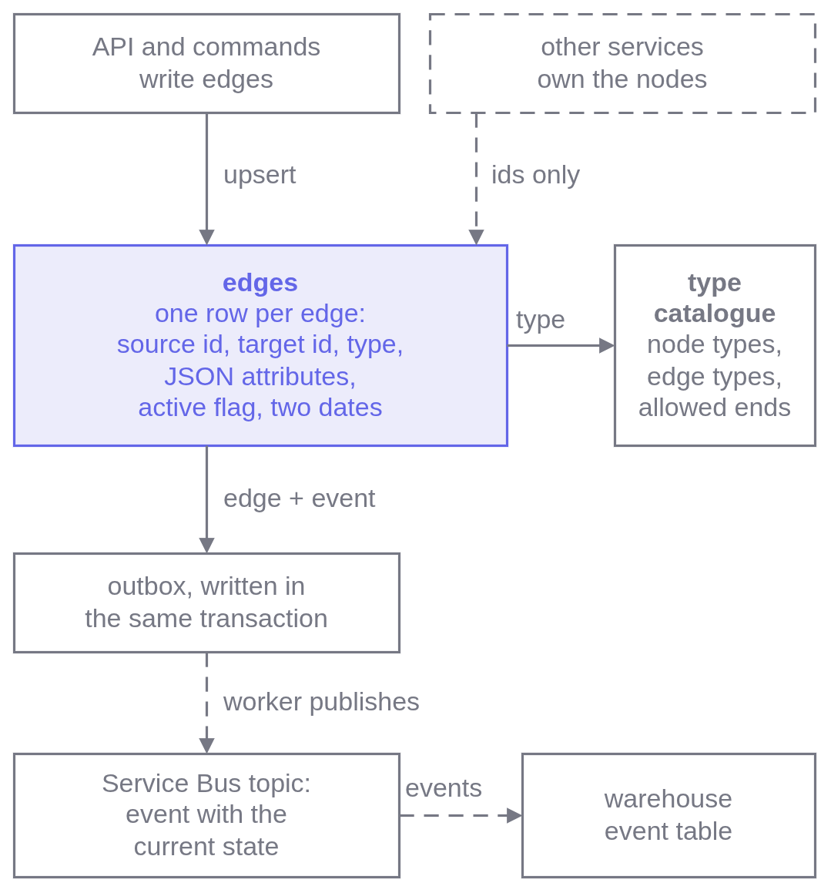
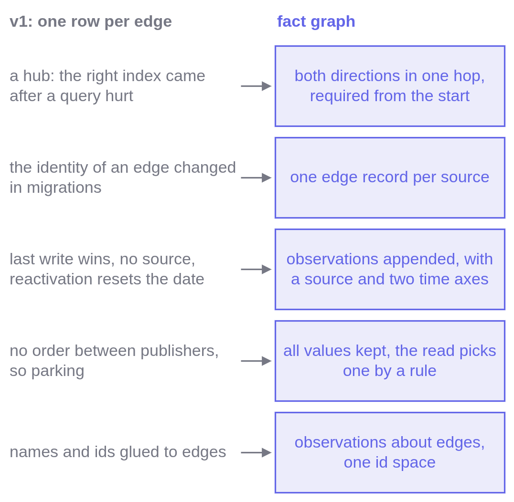

# One Row per Edge

*Our first graph was three tables in SQL Server, and it has run in production since 2024. This is what one row per edge could not remember.*

In October I wrote a verdict on my own service. We had a workshop about the target architecture of our platform, and my pre-read for it had a long table. Each row was a capability we will need, with what we have today and one action: reuse, extend or build. Some rows pointed to the relationship graph I designed in 2024. Next to "typed, directional, attributed edges" I wrote "Reuse, this is the foundation". Two rows lower was provenance, confidence and validity of an edge. There I wrote "the node has it; the edge does not".

The node in that sentence is a company. Its record lives in the service that owns company data, and there the fields already carry a source and a date. The edge was the only thing my graph owned, and it had neither. I think this half sentence is a fair summary of two years in production. The model did what I designed it for. It kept relationships between things that belong to other services. It accepted new kinds of relationships without changes in the application code. And it ran on an ordinary relational database. But an edge was one row, and a row knows only its current state. It does not know where its values came from or since when the relationship exists. It also does not know which of two writers was right.

This post is about that first iteration, which I call v1 from here on. I describe the model and what worked, and then five places where one row per edge stopped being enough. For me these five places are the reasons for the second iteration we are designing now. It is a fact graph, where every value on a node or an edge carries its source and its time, and [the next part](/blog/the-name-is-an-observation/) is about it. It is the same idea, evolved.

## The model

The service has one job: keep relationships between entities that live in other services. There is no table of nodes. A node is the id that the owning service gave to its entity, for example the id of a company in the service that owns company data. A relationship has a type, a source and a target. It also has a flag for active or deleted, and the dates of creation and last change. The service is domain-agnostic. It knows nothing about what a relationship means for the business, so any two entities can be connected.

Writes come in two ways: synchronously through an API and asynchronously as commands from Service Bus. Every change goes out as an event. Access is checked per relationship type, separately for reading and for writing.

My blueprint, the design document for the service, left one decision open on purpose. Should a new kind of relationship be a subtype in code or a value in a type column? During development I recommended the second, so a type is a row. The team built it as two small tables for node types and edge types. Every edge type says which node type may stand at its source and which at its target. In the database the two tables are even marked with the category "configuration", and this is exactly what they are.

In this post I use company ownership from a public register as the example. With it the whole schema looks more or less like this:

```sql
CREATE TABLE node_types (
  id   int PRIMARY KEY,
  name nvarchar(100) UNIQUE              -- 'company', 'site'
);

CREATE TABLE edge_types (
  id               int PRIMARY KEY,
  name             nvarchar(100) UNIQUE, -- 'owns', 'is_subsidiary_of', 'operates'
  source_node_type int REFERENCES node_types(id),
  target_node_type int REFERENCES node_types(id)
);

CREATE TABLE edges (
  id         bigint PRIMARY KEY,         -- from a sequence
  source_id  nvarchar(255) NOT NULL,     -- an id owned by another service
  target_id  nvarchar(255) NOT NULL,
  type_id    int NOT NULL REFERENCES edge_types(id),
  attributes nvarchar(max),              -- JSON, replaced on every write
  is_active  bit NOT NULL,
  created_at datetimeoffset NOT NULL,
  updated_at datetimeoffset NOT NULL
);
```

Around these tables the team added an outbox for events. In the second year they also added a job that copies every event into a table for the data warehouse.



If you expected a graph database here, the short answer is that we measured. In our proof of concept plain tables with indexes answered our questions in tens of milliseconds, also several levels deep. A graph cluster would cost several times more per month than the SQL database. So the plan was SQL Server for storage and a graph engine as a read layer later. The later never came, because no user story needed it. The numbers are in [The Graph Database We Didn't Buy](/blog/the-graph-database-we-didnt-buy/).

## What worked

Types as data worked best. In two and a half years more than a dozen relationship types arrived. Most of them came as one migration with one INSERT into the type catalogue, written by different people in the team, and none of them needed a change in the API or in the events that other services read. So in October I could write without exaggeration that a new type is "one INSERT".

The node as an id worked too. The graph never had to decide what a company is or how to merge two duplicates, because all of it stayed in the service that owns the company. The price is that the graph cannot say anything about the company itself, only about its connections. I come back to this below, because we paid that price later anyway.

The outbox came a few weeks after the first schema. The edge and its event are written in one transaction, and a worker publishes the event afterwards. So a consumer never sees an event for a change that was rolled back. I designed the events to carry the current state of the relationship, with the attributes. That is convenient, because a consumer does not need to call back. But then the content goes to every subscriber of the topic, and the access rules per relationship type are checked on the API, not on the topic. The fact graph turns this around. Its events carry only ids, and the content is read through the API, where the access check is.

## A node with more than a million edges

Some nodes are hubs: they have far more edges than all the others. In our case one target has more than a million incoming edges. The team had an index for each direction since the first autumn. So the simple questions stayed fast, for example all edges from this source or all edges into this target.

The problem came with an export that pages through edges. Its query filters on a set of sources and a set of targets at the same time. The optimizer took the index that starts from the target. Then it had to sort every edge of that target to join it with the sources. For a normal node that is nothing. For the hub it means sorting more than a million rows before the first row comes back, and the team's own note calls it catastrophic. The fix was an index that starts from the source and also carries the target and the id, so now the optimizer can begin on the small side and touch the hub only for the sources it needs.

On relational tables the optimizer does not know that a node is a hub. Every query that filters on both ends of an edge is a bet on which side is small, and we found the hub through one export query, two years in. Graph databases have the same problem under the name supernode, so a different engine would not remove it. What helps is to know your hubs early and to test each query shape against the biggest one. The spec of the fact graph at least makes reading both directions in one hop a requirement from the start.

## The identity of an edge, three versions

In the first schema an edge was identified by source, target and type. These three text columns were the clustered primary key. Four months later the team redesigned the key. A bigint from a sequence became the primary key, and the three columns got a unique index. That worked for almost two years. Between two companies there is at most one `owns`, so nobody needed more.

Then the product needed several edges of the same type between the same pair. In the example domain it looks like this. Company A holds shares of company B in two share classes, and each holding has its own percentage. So we need two `holds_shares` edges from A to B. The team added a qualifier, here the share class, as the fourth part of the identity. It needed two filtered unique indexes: one for edges without a qualifier and one for edges with it. The edge type also got a parent. A `holds_shares` edge needs a live `owns` edge between the same pair. Deleting the `owns` edge soft-deletes all the share class edges under it.

All of this was done carefully and it works. But "what is one edge" was a question we answered three times, each time in a migration. In the fact graph the spec asks this question first, and its answer is one edge record per source. Two sources that report the same relationship give two records, and both stay visible.

## A row remembers only its last write

The write path is an upsert. It runs in a serializable transaction and finds the edge by its identity with an update lock. Then it either replaces the row or inserts a new one:

```sql
SET TRANSACTION ISOLATION LEVEL SERIALIZABLE;
BEGIN TRAN;
  IF EXISTS (SELECT 1 FROM edges WITH (UPDLOCK, HOLDLOCK)
             WHERE source_id = @source AND target_id = @target AND type_id = @type)
    UPDATE edges
       SET attributes = @attributes, is_active = 1, updated_at = @now
     WHERE source_id = @source AND target_id = @target AND type_id = @type;
  ELSE
    INSERT INTO edges (id, source_id, target_id, type_id, attributes,
                       is_active, created_at, updated_at)
    VALUES (NEXT VALUE FOR edge_ids, @source, @target, @type, @attributes,
            1, @now, @now);
COMMIT;
```

This is correct, and the lock is there for a reason: two writers must not create the same edge twice. But look at what it does with the values. The attributes are one JSON document that is replaced in full, so the last writer wins. The value has no source and the table has no history. History exists only in the event table for the warehouse. That table is a feed for the data platform, and the API cannot answer from it.

Deleting is a flag. When somebody writes attributes to a deleted edge, the edge comes back to life. Here is the code that does it, simplified.

```csharp
public void Activate(DateTimeOffset at)
{
    if (IsActive) return;
    IsActive  = true;
    UpdatedAt = at;
    CreatedAt = at;   // the original start of the relationship is gone
}
```

So after one delete and one re-create, the question "since when do A and B have this relationship?" gets a wrong answer. The edge says it was created today. Nobody wrote a bug here. A row has one creation date, and the reactivated edge is in a way a new one.

In the fact graph the values on an edge are observations written next to each other, and each one keeps its source, its time and its trust. Time has two axes there. Valid time says when the relationship was true in the world, and recorded time says when we learned about it. So "since when" and "since when do we know" become two questions with two different answers.

## Two publishers, no order

Customers can put their own labels on edges. A customer creates a label and attaches it to some edges. This produces two messages from two independent publishers: "label created" and "label attached". They can arrive in any order. When the attachment came first, the consumer could not find the label and the message went to the dead-letter queue.

The team fixed it with parking. If the label is not there yet, the attachment is stored as an intent and the message is accepted. When the label arrives, every parked intent for it becomes a real attachment in the same transaction. A duplicate delivery of the same intent is ignored. It is a good fix. But it is a special saga for one pair of messages, and any other pair of independent publishers would need its own.

For the next iteration the lesson has two parts. Something that refers to a thing we do not know yet still has to wait. In the fact graph an observation about an unknown subject waits too, which is the same idea as parking. But when two writers send two values for the same thing, nothing should depend on which one arrived last. So in the fact graph the write does not decide which value is current. All observations are kept and the read decides with an explicit rule. [Part three](/blog/the-name-is-an-observation/) explains the rule, and [part four](/blog/rejected-in-the-morning/) shows why many writers make it necessary.

## The edge started to carry company data

The graph did not want to know anything about companies. But a customer knows the company on the other end of an edge under its own names. It also knows it under identifiers that its integrations use. These things belong to one customer's view of one relationship. So in the second year they landed on the edge as two new tables, one for alternative names and one for integration identifiers, and both of them are keyed by the id of the edge. The identifiers were a list of plain strings without a type. Later nothing could say which entry was the unique id from an older system, and the team added a separate column for it.

This lesson came from the part of the model that worked best. The node was only an id, and it stayed only an id. But facts about the relationship had nowhere to go except new columns and new tables next to the edge. In the fact graph nodes and edges share one id space, so an observation can be about an edge as easily as about a company. Even a name is an observation with a source and a date. The next part takes its title from that.

## Four questions v1 met late

If you build a graph on relational tables, these are the questions our first iteration met in production, one migration at a time:

1. What is the identity of an edge, and what will make two edges between the same pair different?
2. From which side will your biggest node be read, and by which query?
3. Which dates must no operation overwrite?
4. Where does a value come from, and what happens when two writers disagree?

None of them needs a graph database to answer. All four need a decision before the first production row.

## The second iteration

For me the fact graph is the second iteration of the same idea. The node is still thin: an id and a type, with no columns for company data. Types are still data. Events still leave through an outbox in the same transaction. What changes is what I marked as "build" in my October table. In the spec the edge gets provenance, confidence and validity. The graph gets a shared part with a private part for each customer, and traversal over many levels. The labels and the names on the edge were our first private layer, built before we had a name for it.



Meanwhile v1 keeps running, and the team keeps extending it. Last month they added another relationship type, and it was again one INSERT.

---

**Status:** draft

**Scores:** tension=6 originality=5 personal=6 contrarian=4 substance=8 punch=6 trend=4
**Scored:** 2026-11-23 rubric=v1 model=claude-opus-5-5

**Related:** a-feature-is-not-a-service, stop-calling-it-legacy-code, the-migration-that-never-starts

**Tags:** Software Architecture, Data Modeling, Legacy Systems, Domain-Driven Design, Systems Thinking
