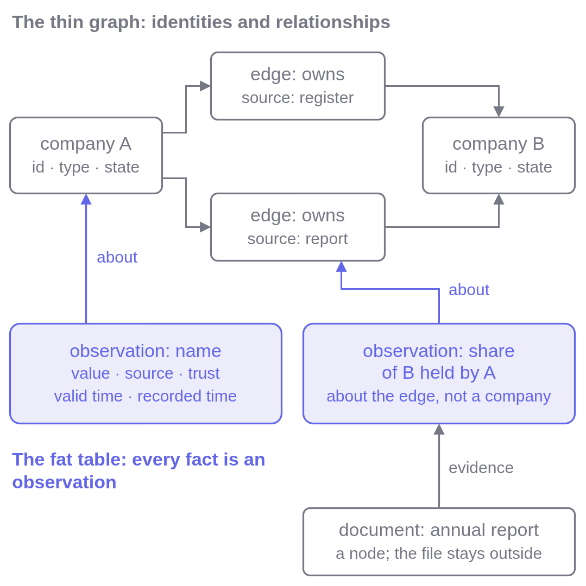
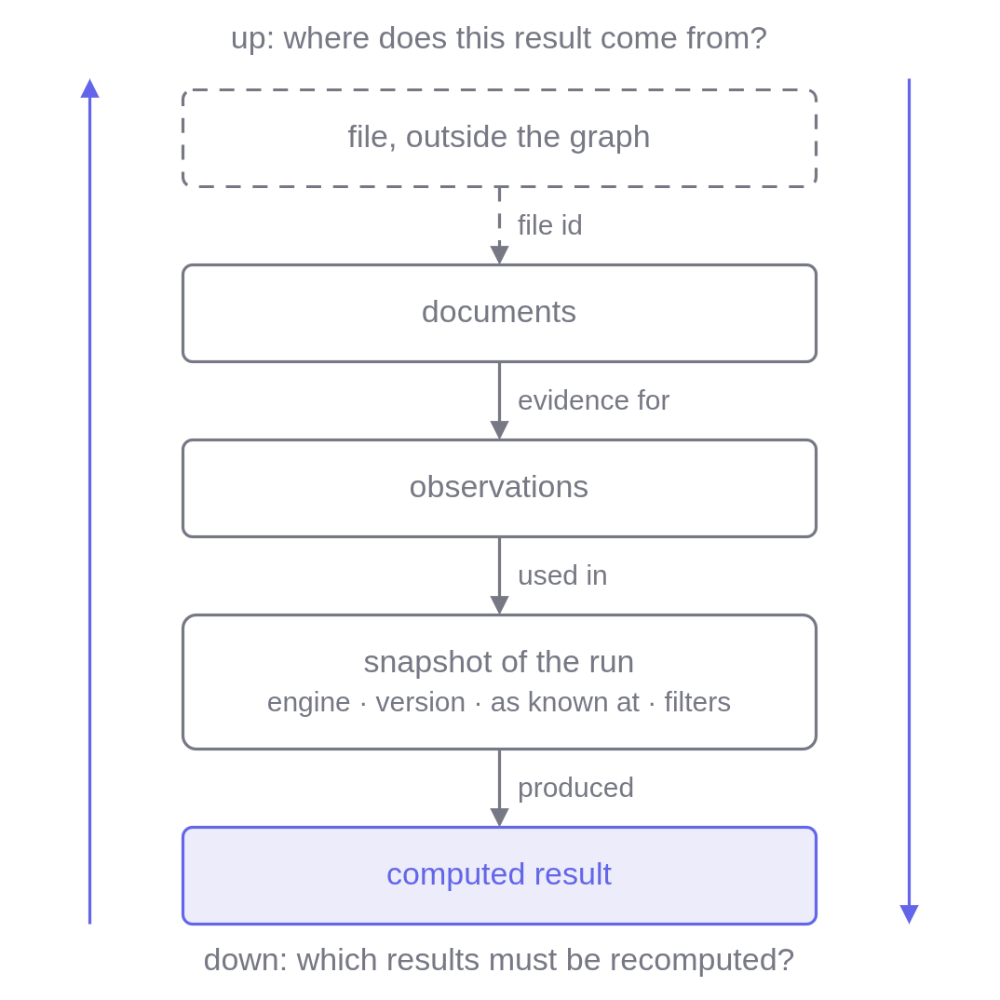

# The Name Is an Observation

*Three sources give one company three names. In the second version of our graph a company is only an id, and even its name comes with a source and a date.*

What is the name of a company? The public register has its legal name. The company's own website uses its brand. A record we migrated from an older system still has the name from before the rebranding. All three are right, each for its source and its moment.

If the node in a graph holds one name, somebody has to pick one when the row is written, and the reason for the pick is lost as soon as the row is saved. In the second version of our graph nobody picks at write time. A company node is only an id. The name is an observation: a value with its source, its date and its trust, stored next to the other two names. The reader picks, with a rule it can explain.

We did not start there. The team built the first graph on the model I designed, and it has been in production since 2024. Its edges had the same blind spot. Every write replaced all attributes of an edge, so the last writer won. And when a deleted relationship came back, a small method called `Activate` set its creation date to the moment of the reactivation. So the model could not answer two questions about any edge. Since when has this relationship existed? And where does this value come from?

This post is about the second version, which starts from these two questions. Version one and its storage are in the [first](/blog/the-graph-database-we-didnt-buy/) and [second](/blog/one-row-per-edge/) part of this series. Here I go through the model of version two and what each decision costs.

## What I wrote down as missing

In October I prepared a review of the first graph for a target-architecture workshop, and [the second part](/blog/one-row-per-edge/) starts with it. My verdict was that it is the foundation. It has typed, directed edges between ids that other services own, and a new relationship type is often one `INSERT`. Then I listed what it lacks:

- provenance, confidence and validity on the edge, because "the node has it; the edge does not";
- a split between the shared part of the graph and the private part of each customer;
- queries that go more than one level deep.

My colleagues wrote the specification of the new graph, and they started from their own ideas and not from my code. I will call it the fact graph: a graph of companies and their relationships in which every fact says where it came from, when it was true, and how much we trust it. I read their spec as the answer to my list, and I describe it here from my side. For me, v2 was the second iteration of the same idea.

Some ideas are the same in both versions. A node is an id from the service that owns the entity. Node types and edge types are rows in a catalogue, which was my recommendation in v1. An edge type says which node types it may connect. Changes go out through an outbox, a table in the same database from which a relay publishes events. What is different is everything that touches time and origin. Attributes became observations, and overwriting became appending. One creation date became two timelines. And events stopped carrying content.

## A thin graph and a fat table of facts

The fact graph has three kinds of records: nodes, edges and observations. Edges and observations carry an envelope, so I start with the envelope.

The envelope is the metadata of one fact. It has five parts:

- the source: who stands behind the fact, and what kind of evidence it is;
- the collector: how the fact came in (channel, run, mapping version, how the value was read);
- the trust: attributes from the collector, and a level that the graph computes;
- the time: when the fact was true, and when we learned it;
- the visibility: who may see it.

The split between source and collector is the part I worked on. I own the collectors, the code in our services that writes facts into the graph, and they fill this part of the envelope. A company report read by a language model is still the company's statement, so a reading error must not look like the company's error. The collectors are the topic of [the fourth part](/blog/rejected-in-the-morning/).

A node is almost empty. Its id comes from the identity service, which decides which records are the same company. Its type is organisation, site or document. And its identity state lets the old id redirect to the survivor on read after two companies are merged. That is all. The node has no envelope, no name, no country and no size. Each of these is an observation.

An edge has a type, two ends and an envelope. There is one edge record per source. If a public company register says that company A owns company B, and A's own annual report says the same, the graph holds two `owns` edges. Each has its own source and date.

An observation is one fact. It has a type with a version, a subject, a value, a value state and an envelope. The subject can be a node or an edge, because nodes and edges share one id space. So "the share of B that A holds" is an observation about the `owns` edge and not about either company. The value state says whether the value is known, not applicable, unknown or not disclosed. "The company does not disclose it" and "it does not apply to this company" are different facts.

A result that an engine computes from other facts is also an observation, only marked as derived, so it has the same lineage, trust and visibility rules as a name from the register. Evidence is a node of type document. The file stays in file storage, the graph keeps its id and hash, and one document can support many facts.

So the three names from the beginning of this post are three observations about one node. When a fourth source arrives with a fourth name, the node does not change at all.

Every decision here has a price:

| Decision the spec proposes | Alternative | What you get | What it costs |
|---|---|---|---|
| Every attribute of a company, even the name, is an observation | Copy the company record into the node | One model for all facts: source, trust and history for everything | Every read of a name is a choice between values, so every reader needs a rule |
| One edge record per source | One edge per relationship, sources merged | Conflicts between sources stay visible | No natural key for "this relationship": a fact about it must point at one source's edge, or you derive a key from both ends and the type |

## The read decides

The most important decision in the model is what happens with a correction. Here is a small example: one company's number of employees, three records from two services.

- Monday: service A writes **500** from the public register.
- Tuesday: service B writes **480** from the company's own report.
- Wednesday: the register publishes a correction, and service A writes **520**.

What does the graph hold, and what does it show as current?

| | Supersede: the correction replaces the old value | Parallel observations and retraction |
|---|---|---|
| What is stored | three rows, only the last one is current | three rows, all current, each with its source, trust and date |
| Who picks the value | the write: a newer write replaces an older one | the read: a rule picks, for example highest trust, then the newest period, then the newest version from the same source |
| 480 against 500 and 520 | disappears without a trace | stays visible and can open a review |
| A collector bug | a new write replaces the bad one | the bad row gets a retraction with a reason; it drops out of current reads and stays in "what we knew then" |

Supersede looks simpler, and with one writer it works. Our system does not have one writer. Facts come from many services, each through its own outbox, and delivery is at least once. Order is guaranteed only per subject inside one service. Nobody keeps an order across services. So Monday's 500 can reach the graph after Wednesday's 520. Maybe it came through another service that reads the same register. Or it was replayed when old raw records were re-mapped with a corrected mapping. With supersede, "latest" then means "arrived last", and the graph shows 500, only because of the order of delivery. With parallel observations the arrival order changes nothing: the set of observations is the same, so the same rule picks the same value.

You could make the write smarter and let it compare the source's own times. But then the write has to decide which records are "the same fact", and 480 against 520 still disappears, because two sources never supersede each other.

If you want a correction from the same source to win, the read can do that too. Inside one source, it takes the newest value by the source's own time, not by the time of arrival. Superseding moves from the write to the read. The graph spec says the same thing: the graph returns all matching observations, and choosing the best one is the job of the engine that reads them.

This was also my first idea. The first draft of my collectors spec said that conflicts stay visible and that every review decision is a new data point, never an overwrite. And v1 met the same problem in production. Two services sent related messages in random order, and the team had to add parking for messages that came too early. That story is in [the second part](/blog/one-row-per-edge/).

There is one trap. A read rule needs a last tie-break, and the natural one is "then the one recorded last". I found exactly this line in the first engine that reads our facts. It looks harmless. But when everything else is equal it picks by arrival time, so supersede by delivery comes back through the read side. In my opinion the tie-break should use the source's time. When even that is equal, the conflict should stay visible and not be decided by the clock of the graph.

Retraction is only for garbage, for example when a collector had a bug in its mapping and wrote thousands where the source said units. A source that disagrees with another source keeps its observation. At-least-once delivery also needs two idempotency keys, one for a repeated delivery and one for a re-mapping, but that belongs to the fourth part.

## Two timelines

Every edge, observation and document has two times. Valid time says when the fact was true in the world: from, to, or the period it describes, like a financial year. Recorded time says when the graph learned it. An optional third field keeps the time when the source learned it, for records migrated from older systems.

Why two? Because "the ownership ended in June" and "in April we learned that the ownership never existed" are different facts. A result computed in March has to be defensible after April. So the read takes two parameters: "as of" for valid time and "as known at" for recorded time. Both default to now. The read predicate is two range checks:

- valid from ≤ as of ≤ valid to, in whole days, inclusive;
- recorded at ≤ known at < retracted at, as an instant, with an exclusive end.

Who sets recorded time? If the writer sets it, anybody can write into the past. Then "what we knew in March" becomes "what somebody says we knew in March". So the spec says that the graph stamps it, never the writer. Migrated history goes into the separate source field. Without that field, the recorded time of migrated data is the load time. The "as known at" view before the migration day is then empty, and nobody can defend an old result.

In practice the rule has exceptions. In a colleague's reference model in PostgreSQL a trigger stamps recorded time on insert and makes a retraction final, but import sessions are exempt. And the first fact store in our code takes recorded time from the caller. Every such exception is a door to write into the past, so I would keep their list short and written down.

What does "as of" cost? To be honest, I do not know yet. A B-tree index with two range columns seeks well on one of them and only filters on the other. The spec budgets "as of" reads at twice the time of a current read. I have not seen this measured on real volume. The options I would test first are a partial index on current rows only, range types with a GiST index in PostgreSQL, and temporal tables in SQL Server, which keep recorded time natively.

Append only has its exceptions too. The spec names six of them, from retraction and a new trust score after the rules change to legal erasure. Everything around the facts must be versioned too. A redirect after a merge of two companies needs its own history. After an unmerge, one mutable "merged into" field cannot say where an id pointed as known in March. Access grants are closed and never deleted. Type definitions have versions. Bitemporality is cheap in the predicate and expensive in everything around it.

## Lineage, and how much of it to keep

Lineage answers "where does this result come from?" In the fact graph the path starts at a computed result. It goes to the snapshot of the engine run, which records the engine, the calculation version, the "as known at" moment and the filters. From the snapshot it goes to the observations the run used, then to the documents that support them, and to the file. Outside the graph it continues from the observation to the mapping version and the raw record that the collectors keep.

You can walk this path in two directions. Up, to explain where a result came from. And down, to find which results must be recomputed when an input changes.

The real decision is granularity. It is a dial between volume, precision, and how much of the calculation you show to the world.

| Option | What you get | What it costs |
|---|---|---|
| A list of input ids inside the result | compact | no native way down: finding the results that used an input is a scan |
| One snapshot per run, with a "used" edge to each input (the spec proposes this) | replay, the path up and a native path down | it cannot say which input fed which result |
| An edge from each result to its inputs, with weights | an exact explanation | it shows how the calculation works, and the volume multiplies |

The spec takes the snapshot per run. For recomputation it loses nothing, because the run is the unit you recompute anyway. It loses only precision in the explanation, and edges per result can come later without a change of the model. Lineage says what a result was made from, not how. Weights and rules stay out of the graph.

Two more details I like. The API has no way to write a computed result without a snapshot. So lineage is guaranteed by the shape of the API and not by the discipline of every engine team. And replay has an honest limit. The same snapshot and the same calculation version give the same result only for a pure function. When a person decides something in the middle of the run, the snapshot is a record of what happened, not a recipe to repeat it.

On volume, the spec expects on the order of a hundred million observations a year. That fits on one database server, but only if observations, lineage edges and the access log are partitioned by time from the first day.

## Trust is data plus a versioned rule

Who decides how much we trust a fact? In the simplest model the writer does. Every record has a trust level, and a higher level wins. Then a collector can give itself the highest level, and when the rules change, nothing can recompute the old values.

The spec proposes something else. The collector supplies only attributes: the kind of evidence, how the value was read, whether a person reviewed it, and whether somebody external confirmed it. The graph computes a level and a score from them with a trust ladder, which is a versioned table of rules. It stores the ladder version next to the result. When the ladder changes, the graph appends a new trust score and keeps the old one. A current read uses the newest ladder. An old snapshot keeps the trust that was valid on the day of its run.

Who owns the ladder is still an open question. And there is one question the graph cannot answer alone. When the ladder changes, or two merged companies are split again, the graph knows it. But a result computed earlier has to learn about it too. That needs an event, a recomputation, and somebody who decides that the result is issued again.

## One transaction picks the database

Writing one observation takes seven steps, in one transaction:

1. check access;
2. check idempotency;
3. check the type against the catalogue;
4. check that the subject is known;
5. compute trust;
6. write the record with its recorded time;
7. put the event into the outbox.

The catalogue and the trust ladder come from a cache in the same process. The cache is invalidated in the same database when a type changes, so the type check needs no network call.

This one transaction explains two other decisions. First, the spec proposes a modular monolith instead of a service per module. A write that spans validation, trust and the outbox across several services would need a distributed transaction, or it would lose its guarantees. Second, events carry only ids. A consumer reads the content through the API in its own customer's view, because an event with content would go around access control. The target for event delivery is half a minute. Recomputation is not interactive, so that is enough, and an outbox relay can meet it.

The same transaction decides the storage more than traversal does. Traversal over several levels is one of the requirements in the spec. But customer isolation in the data layer, immutability with two timelines, the one transaction and the volume weigh more. The spec compares six kinds of stores, from PostgreSQL and Azure SQL to Cosmos DB and a native graph database. Its direction is a relational source of truth, with a graph engine at most as a disposable projection if measurement shows that traversal is too slow. The final choice is still open. For me it is the same decision as in v1 in another SQL engine, and [the first part](/blog/the-graph-database-we-didnt-buy/) shows where it came from.

## A shared graph leaks through its structure

The fact graph has a shared world and a private layer for each customer. Hiding the values is the easy part. The leaks go through the structure.

An edge is visible only to someone who can see both of its ends. When a customer adds a company, the identity service resolves it to an id, and this step is lineage too. The number and the timing of these resolutions would tell a customer who else asked about the same company, so that part of lineage is shown only as a summary. For relationships beyond the first step, for example how many companies sit two steps away in each country, the spec proposes to show only aggregates built from at least three customers. Small cells also have to be merged with others. Otherwise a hidden cell can be recovered by subtracting the shown cells from the total. So in a shared graph "who can see this" is a modelling question. It has to be answered in the model, not only in the API.

## What I would copy

If I started a third graph tomorrow, I would take four things from this design. A thin graph with a fat table of facts next to it. Facts that never change, with the read picking the value. Recorded time that only the database stamps, with a short written list of exceptions. And lineage granularity chosen on purpose and written down as a decision, because a year later nobody remembers that it was a dial.

One thing is still open for me: what "as of" really costs. The spec says twice a current read. I would like to see that number measured on a year of data before anybody promises it to a product team.

---

**Status:** draft

**Scores:** tension=5 originality=6 personal=5 contrarian=7 substance=9 punch=6 trend=6
**Scored:** 2026-11-23 rubric=v1 model=claude-opus-5-5

**Related:** a-feature-is-not-a-service, data-driven-theater, decisions-have-an-architecture-too

**Tags:** Software Architecture, Data Modeling, Domain-Driven Design, Systems Thinking, Decision Making
