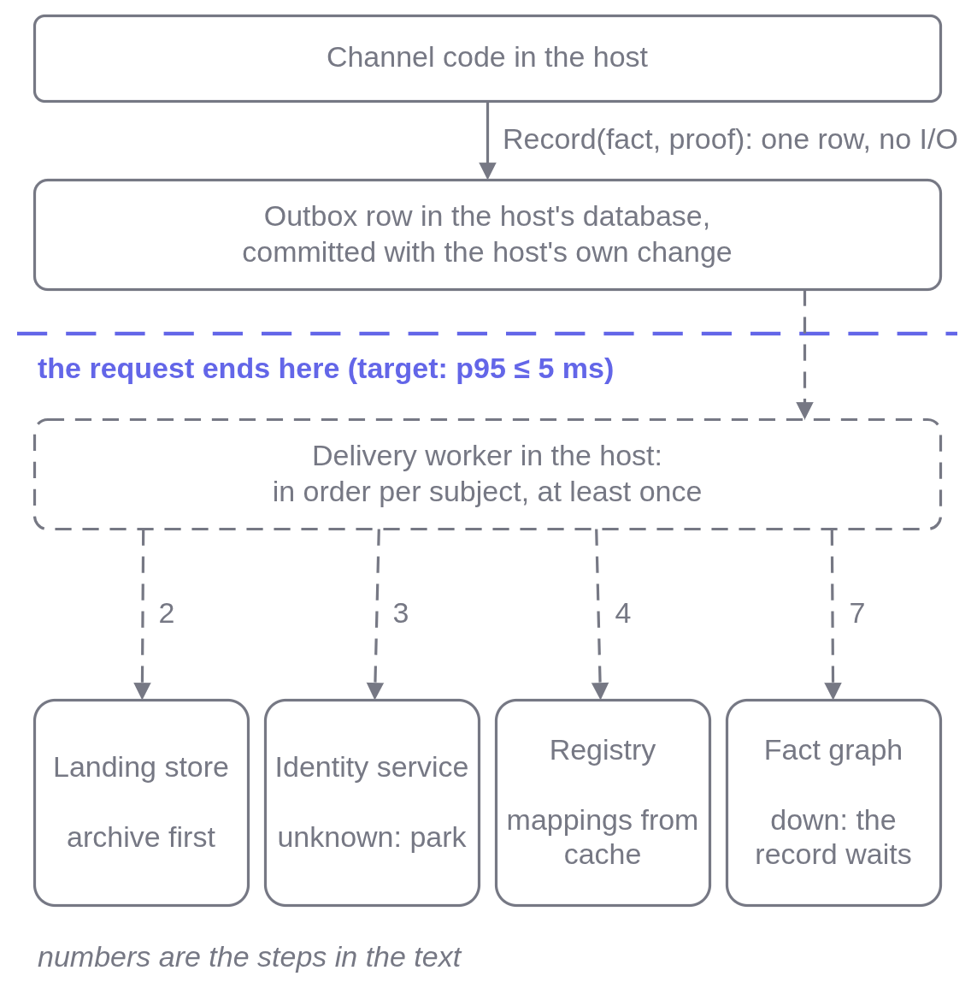

# Rejected in the Morning

*At 11:02 my spec rejected one option: every collector writes straight to the graph. At 21:51 the same spec made it the design, with one library in between.*

On one day in October I committed two versions of the same spec. The first went in at 11:02. It described the component I own, the one that brings facts into our new fact graph, as twelve containers. There was a collector service for each kind of channel, a landing store for raw records and one central intake service. The intake mapped every record and was the only writer to the graph. In the list of alternatives that I did not choose, there was one short line: every collector writes straight to the graph.

The second version went in at 21:51. Its commit message was "make the collector a trait that any service adds". A trait here is a capability that a service adds to itself, a bit like a mixin. There is no central intake in this version. Every service that learns a fact records it in its own database and in its own transaction. Then a library inside the same service delivers it to the graph.

So the option I rejected in the morning became the design in the evening. Almost. The difference is one library, and this post is about what that library has to carry so that many writers still behave like one. It is also about the price, because the evening version is not free.

## Why one way in

This is part four of a series. We are designing a graph that keeps facts about companies, and every fact comes with its source, its time and a level of trust. [Part 3](/blog/the-name-is-an-observation/) is about the graph. This part is about the way in.

Facts come from many places. People fill in forms and upload documents, we read public registers and buy data from providers, and a language model reads the company's own website. Today most products have their own path for this. So we have N products, N write paths and N rules for trust, and one fact that arrives through three channels never becomes one fact. The briefing I prepared for the other architects starts with an inventory of the systems we already run. Its headline is one sentence: provenance dies at every service boundary. The value crosses the boundary and the information where it came from stays behind.

So the job of the collectors is narrow. They record each fact once, where it is learned, with its proof. Every fact gets an envelope, and the envelope carries:

- the source, meaning who stands behind the fact;
- the collector: the channel, the mapping version and how the value was read;
- the attributes from which the graph computes trust;
- two timelines, when the fact was true and when we recorded it;
- the visibility, meaning who may see the fact.

We designed the envelope and the write contract together with the graph team. In this post the service that learns the fact is the host. The host passes the proof and the collector library fills the envelope from it, so host code never sets a trust level or a fact type.

## What changed in ten hours

The morning version had good reasons, and they are still in the spec. One intake means one trust process and one place that keeps the write rights. And with a collector service per channel, a slow document reader cannot hurt the form channel.

In the evening commit message I wrote down the problem. The spec listed endpoints for forms, answers and pre-filled values as the API of my component. Those endpoints belong to the services that run the channels. A collector service for forms would be a second copy of the form application, owned by another team. The same was true for every channel.

Some services also learned facts and threw them away. The first host in the evening version is a sign-up flow. It reads the company's website with a language model, shows the result to the user and saves nothing. In the morning design this service would call a remote collector over the network, outside its own transaction. An outbox in the service would fix that part, and I come back to it below. In the evening design it adds one row to its own database. The fact is safe the moment the sign-up is saved.

For me the biggest gain is organisational. Nobody central stands on the write path: no central service that must scale for everybody, and no central team whose backlog decides when your channel can record facts. But then the hard question is organisational too. How do you keep one way of recording facts without a gate in the middle? It is the gap I described in [Nobody Owns the Sum](/blog/nobody-owns-the-sum/), and here the answer is mostly technical.

## Five places to run the write

The spec compared four options. I add a fifth, B', because it makes the comparison more honest.

| Option | Gains | Costs |
|---|---|---|
| A. Fat trait (chosen): the library in each host archives, maps and writes | no central service or team on the write path; one host's delivery problem does not touch the others; one library, so one trust process | write rights in every host; a fix arrives only after hosts upgrade; two library versions run at once; a table, a worker and a migration in every host |
| B. Thin trait: the host sends raw records, a central intake maps and writes | write rights and mapping in one place; one identity writes; no version drift | one more service on every host's delivery path, and it must scale and stay up for all |
| B'. Thin trait with a host outbox: as B, but the raw record first commits in the host | the request never waits; mapping stays central | one more hop per fact; a central team on everybody's write path |
| C. Sidecar per host | independent of the language | a runtime our platform does not use; one more moving part per replica |
| D. Service per channel (the morning version) | strong isolation | a second copy of each channel; a network hop per fact; one deployable per collector |

In every option the landing store is a hard dependency of delivery. Nothing reaches the graph before its raw record is archived, so no option removes the central archive.

The interesting pair is A and B'. With an outbox in the host, both protect the user's request: the fact commits with the business change and leaves later. So the choice between them comes down to the number of hops, and even more to whose service and whose team sits on the write path. B' keeps mapping and write rights in one place, which is cleaner. A is a bet that we can pay the costs of distribution with automation.


## A trait in a language without traits

Our services are .NET, and C# has no traits with state. A default interface method cannot hold a table, a worker and message subscriptions, and a collector needs all of them. So the trait is a library plus a generic constraint. ASP.NET Core does the same for data protection keys: a `DbContext` that implements `IDataProtectionKeyContext` can store the key ring. Here the `DbContext` implements `ICollectorOutboxContext`.

The spec proposes four steps to make a service a collector. The library does not exist yet, so this is the target API:

```csharp
// 1. Register the collector, right after the service's DbContext.
builder.AddCollector<RegistrationDbContext>("registration", collector => collector
    .Channel<CompanyWebsiteReading>("company-website"));

// 2. The outbox is a table on the service's own DbContext.
public sealed class RegistrationDbContext(DbContextOptions<RegistrationDbContext> options)
    : DbContext(options), ICollectorOutboxContext
{
    public DbSet<CollectorOutboxRecord> CollectorOutbox => Set<CollectorOutboxRecord>();
}

// 3. A generated migration, never a hand-written one:
//    dotnet ef migrations add AddCollectorOutbox

// 4. In the Aspire AppHost: references and role assignments for the host's identity.
registration.WithCollector(collection);
```

The compiler checks step 2 through the constraint `where TContext : DbContext, ICollectorOutboxContext`. An architecture test checks the other three. We also looked at a source generator, but it was more machinery than a test for the same check.

## In the request, and after it

Inside the request the host calls one method:

```csharp
collector.Record(reading, new Provenance(
    SourceKey: $"website:{domain}:{captureHash}",   // stable, so a retry is the same fact
    Evidence: Evidence.WebPage(url, captureHash),
    Extraction: Extraction.Llm(model, promptVersion),
    SubjectHints: SubjectHints.Organization(name, identifiers, address)));

await db.SaveChangesAsync(ct);   // the fact commits with the sign-up, or not at all
```

`Record` adds one row to the outbox in the same `DbContext`. It does not save and does no I/O. The target is at most 5 ms at p95 on top of the host's transaction. If the sign-up rolls back, the fact never existed.

Everything else runs later, in a background worker inside the same host:

1. The worker takes pending rows in order per subject, at least once, with backoff.
2. It archives the raw record in the landing store, once, with a hash.
3. It asks the identity service who the fact is about. An unknown subject parks the record until an identity event arrives.
4. It maps the record with the active mapping version. Mappings live in the registry, a small central service, and the worker caches them. Shadow mode stops here: a new collector or mapping first runs without writing to the graph, so we can compare its output.
5. It stamps the evidence: evidence level, how the value was read, calibrated confidence and valid time.
6. It opens a review task when confidence is low, values conflict or the threshold needs a person. The review never blocks the write.
7. It writes to the graph in batches with idempotency keys and gets one result per record.



Four mistakes break this without any error. `Record` after `SaveChangesAsync` adds a row that nobody commits, unless a later save takes it along by accident. `Record` on a second `DbContext` never commits. A host without `WithCollector` starts fine and its outbox only grows. A random source key duplicates the fact on every retry. The spec gives each of them a test.

One limit I want to say clearly. A heavy host can run the worker in a separate process with the same library. That protects the host's CPU, but the outbox and its load stay in the host's database.

## The price of many writers

Option A has costs. The spec lists each one with the answer it proposes:

| Cost | Answer in the design |
|---|---|
| every host can write to the graph | on every write the graph checks that the caller is the collector in the envelope and may produce this type; the registry publishes the list |
| hosts upgrade late | target: at most one minor version behind; each mapping version names the oldest library that can run it; an older host parks the record |
| logic drifts between hosts | mappings are declarative data; host code never names a fact type |
| one host's mistake reaches the shared graph | shadow mode for every new collector, channel and mapping version; quarantine for rejected records |
| a host without EF Core | a second outbox implementation, same transaction |
| a system that cannot run .NET | it publishes events, and a bridge host records them |

The last rows need a fair note. Parked records from old hosts go to a central re-mapping host. Systems that cannot run the library go through a central bridge host, and one of our biggest channels is such a system. So the fat trait keeps central processing for the laggards, and for that one big channel the hop I removed in the evening comes back.

When something fails after the request, the host notices nothing. The record waits or moves aside:

- the graph or the landing store is down: the record waits, because nothing goes to the graph before the archive;
- the registry is down: the worker maps with the cached version;
- the subject is unknown: the record parks, with a target of 90 days;
- the graph rejects a record: it goes to quarantine and the rest of the batch goes on.

The only failure the host sees is the rollback of its own transaction. Then there is nothing to deliver.

## Many writers cannot overwrite

Option A also has a consequence for corrections. Many hosts write at least once, with retries, and nobody keeps an order across hosts. Order holds only per subject inside one host. So a value read on Monday can arrive after Wednesday's correction. If a new record replaced the old one, "latest" would mean "delivered last", and that is random. You could compare source times on write and keep only the newer value, but then the older value and the disagreement between sources are gone.

So every record becomes a new observation next to the old ones, and the read picks the value. [Part 3](/blog/the-name-is-an-observation/) explains the read rule with an example. For collectors it means two idempotency keys, for two kinds of repeat.

A retry is the first kind. The outbox sends the same record again because the acknowledgement did not come, and the graph must skip it. The **delivery key** is the collector, the channel, the source key and a hash of the payload.

A re-mapping is the second. Say a mapping read a value in thousands as units. We fix it and replay the same raw records with version 2. Now the graph must write a new observation, and the old, wrong one gets a retraction. So the **observation key** is the delivery key plus the mapping version. Without it the graph answers "I have this already" and the fix disappears without a trace. My spec has the long key in one place and the short one in another. Both are right, each for its own repeat. The trait also needs a call next to `Record` to retract a record with a reason, and the contract does not have it yet.

## Raw first, mappings as data

The worker archives the raw record before it maps anything, in the words of the source and with its hash. So we can reproduce a value later, change a mapping without asking anybody again, and read an old source again with a better model.

The same fact can come from several variants of a question, from a document or from an API. A question is only a channel. A mapping turns the channel's raw record into a fact. It is data in the registry, with a version and a status (draft, shadow, active, retired), and a new version needs no host release. The rule format is not specified yet, so this is only an illustration:

```json
{
  "mapping": "company-website.legal-name",
  "version": 3,
  "status": "shadow",
  "recordType": "CompanyWebsiteReading@1",
  "type": "company.legal_name",
  "minLibraryVersion": "1.4",
  "rule": { "value": "$.legalName", "transform": ["trim"], "whenMissing": "unknown" }
}
```

Here the main benefit meets two open problems. Re-mapping is the reason to keep raw records, and the spec plans to re-map on the order of a hundred million records in about a day. That is more than ten times the write rate the graph spec plans for, so the bulk path will need its own lane and throttling. And without the mapping version in the observation key, that whole day of work would write nothing.

## The engine judges, the planner plans

Everything so far was the push path. The pull path starts on the other side. The engine that computes results finds gaps and sends one command: collect these gaps for this subject, each with a reason, a threshold and a deadline. A planner in the collectors decides how to fill them.

In the morning version the planner also evaluated requirements, so two components could disagree about the same fact. The engine team already computed four gap reasons in code. A consistency review across the specs proposed that the engine judges and the planner only plans. I adopted it on the collectors side, so we wrote the contract from the code that already existed:

| Gap reason | Meaning | Strategy |
|---|---|---|
| missing | no value at all | cheapest channel first; ask the subject only if nothing else meets the threshold |
| stale | every value is older than the maximum age, counted from the end of the period the fact is about | ask the same source to refresh; if we ask the subject, show the old value |
| untrusted | fresh values exist, but none comes from an allowed source or reaches the minimum trust | raise trust instead of collecting again: a review, or a confirmation with proof |
| unaccepted | the subject answered without a usable value, for example "I don't know" | do not ask the subject again until that answer is stale; meanwhile try other sources |

The age rule in the second row is easy to get wrong. An old report loaded today is still an old report, so its age counts from the end of the period it is about.

Then the planner walks a cascade from the cheapest source:

1. what the graph already has;
2. raw records we stored before, mapped again;
3. free public registers;
4. documents the subject already shared;
5. paid data providers;
6. a model reading the public web;
7. estimators, if the threshold accepts estimates;
8. the subject;
9. a reviewer.

Tasks are merged per subject and type, so the subject is asked once even when three products need the same fact. One thing is still open. The engine judges at one moment and the planner checks new facts later, and if the graph changes in between, the two can disagree about the same gap.

## Reading is not inferring

The source of a fact and the way it was read are two separate fields. When a language model reads the company's own website, the fact is still the company's declaration. A reading block next to it says which model read it, with which prompt version and how confident it was. So when the model reads it wrong, we see a reading error. The company does not look like it said something false.

The confidence is calibrated per field on golden sets, because a model's own probability is a poor measure. Below the threshold the trait still writes the value with its low confidence and opens a review task. Agents propose, people decide what counts.

## The rules ship as a skill

Next to the spec there is a skill for coding agents. It has a checklist for the four steps and a script that fails on fact type codes in host code, direct writes to the graph, hand-set trust levels and random source keys. It also has evals. In one of them the agent is asked to build a new service only for collecting, and the expected answer is to argue against it. The target is a collector wired in two days or less. The library does not exist yet, so for now the skill stops and says so. It is the idea from [Every Approval Is a Missing Rule](/blog/every-approval-is-a-missing-rule/): a rule that a script can check should not wait for a person.

## What I will check first

The morning version rejected direct writes for a good reason, one trust process. The evening version keeps that reason with one library and gives up one place for the write rights. I chose that trade on the same evening, and it is a bet. With the first host we will see whether it was the right one.

That host is the sign-up flow that reads a website today and keeps nothing. It has to prove the four steps on a live service in the first weeks, before any bigger channel. The library, the registry and the landing store come first, but with this one service using them from the start. I wrote about that kind of first step in [Design the Stopping Point](/blog/design-the-stopping-point/).

The bulk lane is what I cannot answer yet. A fat trait is easy to defend for a form that saves one record at a time. The re-mapping host replays the whole archive, so for it the central path is back, and nobody has decided how much of the graph's write capacity it may take.

---

**Status:** draft

**Scores:** tension=6 originality=6 personal=6 contrarian=6 substance=8 punch=6 trend=7
**Scored:** 2026-11-23 rubric=v1 model=claude-opus-5-5

**Related:** a-feature-is-not-a-service, nobody-owns-the-sum, design-the-stopping-point

**Tags:** Software Architecture, Data Modeling, Domain-Driven Design, Systems Thinking, Organizational Design
