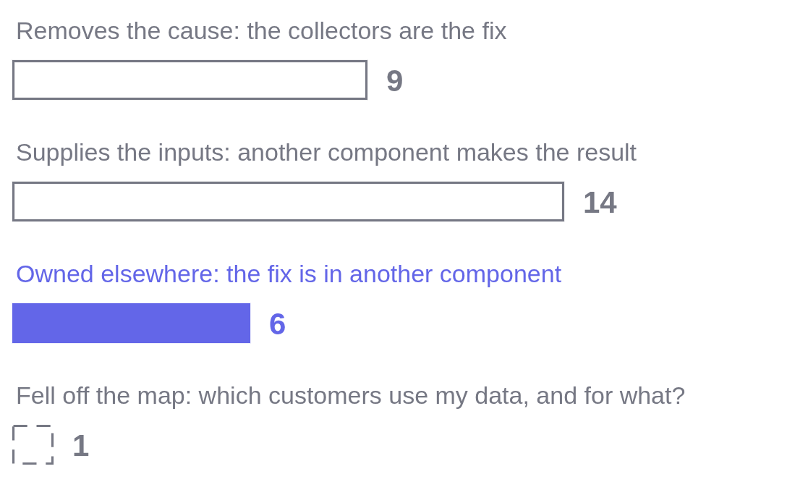
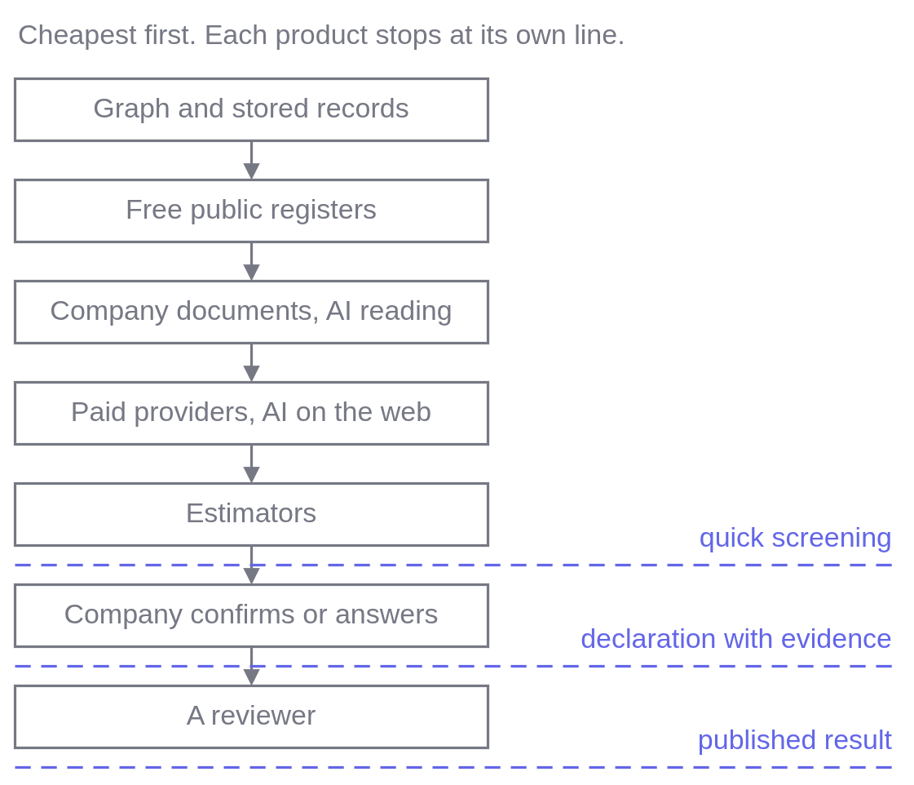

# Owned Elsewhere

*Product wrote down thirty problems and I mapped them onto my component. Six times my answer was "owned elsewhere", and one problem never reached the map.*

Six times I wrote "owned elsewhere". It was in a map I made last autumn, where I set each problem from a list our product people wrote against the component I own. That component is the collectors: the part of our new data layer that brings facts into the fact graph together with their source, their evidence and their time. For every problem I could give one of three verdicts. My component removes the cause. Or it supplies the inputs and another component does the rest. Or the problem belongs to somebody else.

This is the last part of a series about that data layer. The earlier parts were about how it works inside, from [the graph database we did not buy](/blog/the-graph-database-we-didnt-buy/) to [how any service can become a collector](/blog/rejected-in-the-morning/). This part asks what a product manager gets from all of this, and what they do not get.

The list came from four people in product and it was raw. It had open questions, two strategic use cases, problems our customers report and needs of the companies whose data we keep. One line in it said that provenance is the main problem behind these use cases. Provenance means the origin of the data: where a value came from and what happened to it on the way. I quoted that line in the map. If provenance is the main problem, the component that captures provenance should be able to say what it changes for each problem.

The map says the list has twenty-nine problems. Nine got "removes the cause", fourteen got "supplies the inputs" and six got "owned elsewhere". When I prepared this article I compared the map with the raw list once more. The list has thirty.

## Three columns

The first column is for problems where a missing way of collecting is the cause. Here the collectors are the fix. The same fact is asked for again in several places, because an answer belongs to the form where it was given and not to the company it describes. Nobody can say where a value came from, when it arrived and how it was checked. A value from an external API cannot replace a question, because it has nowhere to sit next to the answer.

The second column is the biggest one, and honesty costs the most there. Fourteen problems need the collectors, but somebody else makes the result. Examples are an explanation of how each input led to a result, roll-ups from one site to a group of companies, experiments with a new source and estimates. So each card on the map has one more field called "needs also". It names the component that does the rest. Without it a quick reader adds nine and fourteen and goes away thinking that the collectors solve twenty-three problems.

The third column is for problems where the fix lives in another component. A customer wants to compute their own result from our data with their own method. A company wants to compare its numbers with its peers for each input. Another wants to control which customer sees which of its data. Twice the problem was an explanation that only the calculation can give, for example how a risk was computed. For a component owner this is the most useful column. It lists the conversations that are not mine and says with whom they are.

The verdicts are my reading as the architect, written for discussion. When I made the map, product had not agreed with them, as the last line of the map says.

## What the fact graph should answer

If I take the nine and the fourteen together and ask what a product manager could promise a customer, I get four questions. The answers below are what the specs propose.

The first is "why do you ask me again?" The collectors first check what the graph already has and then try the cheapest source. They ask the company only for what is left, and only once, even when three products need the same fact. The second is "where does this result come from?" From a computed result you can go up to the observations it used and to the documents behind them. Whatever the reader may not see is marked as withheld, so they know that something is there.

The third question is "what did we know on the day we issued it?" The graph keeps two timelines: when a fact was true and when we recorded it. Every computed result also points to a frozen snapshot of its inputs. Product people should know one limit here. With a pure calculation, the same inputs and the same version give the same result again. When a person was part of the work, the snapshot only records what happened, and running it again will not repeat that person's judgement.

The fourth question is "is this still fresh?" The age of a fact counts from the end of the period it describes, so an old report that we loaded this morning is still old. The mechanics behind all four answers are in [part three](/blog/the-name-is-an-observation/) and [part four](/blog/rejected-in-the-morning/).

One more thing for the product side is easy to miss. In my spec a new computed result can be tried on the data we already have. The stored raw records are mapped again in a dry run, and you see the coverage and the mix of trust levels on a pilot group. You also get a plan of what would be asked and of whom, before anyone is contacted.

## Where the architecture stops

One problem on the list was easy to state. A customer wants to see the inputs behind a result, meaning the answers and the documents, and not only our analysis of them. Most people would expect a new data layer to fix exactly this, and partly it does. In the design the collectors keep the original answers and documents as raw records. Each record is linked to every value it supports and carries a visibility class. So the data exists, and we can say where every value came from.

The customer still cannot see it, because the second half of the problem is a decision about sharing. Who owns the company's answers? Did the company agree that a paying customer reads them? On what basis does an engine read them at all? (An engine is the code that computes results from the facts.) An architecture can make the data and its origin exist. It cannot decide that we are allowed to show it, and to whom. In my map this problem got "supplies the inputs". Under "needs also" it names the access rules and the terms we have with our customers.

For me this was the main lesson of the map. Most of the hard open questions in this part of the platform are about ownership, consent and price. No schema closes them. The architect can do one useful thing with them: put each one on the table with somebody who decides and a date. In my collectors spec every open question has a column "decides" next to "raised by" and "directed to". I wrote in [Questions Are an Architect's Sharpest Tool](/blog/questions-are-an-architects-sharpest-tool/) why a question without an owner and a date is only a sigh.

## The problem that fell off the map

The thirtieth problem was one of the needs of the companies whose data we keep. A company wants to see which of our customers use its data and for what purpose. The raw list has ten needs from that group, and the map has nine.

The nearest answer in the design is the access log of the fact graph. A customer reads a company's data under that company's consent. The log then records who read it and under which consent, and the company can see the log. So the log answers "who". It does not answer "for what". As far as I can see in the specs, nothing records the purpose of a read.

Maybe I simply missed it when I counted. But the map also had no good place for it. Every column points to a component: mine, mine plus another one, or another one. A problem that fits no component has no column to go to. This one sits between the access log, the consent and the product that uses the data, and none of them owns the purpose. I wrote about this kind of orphan in [Nobody Owns the Sum](/blog/nobody-owns-the-sum/), where every part has an owner and the whole has only hope. Here the orphan is a single question, but it fell through the same gap.

## Trust is a price list

In the graph spec every value has a trust level. There are five levels, from the lowest: an estimate, a declaration by the company, validated by AI, validated by a reviewer, and attested by an external party such as an external audit. Nobody sets the level by hand. The collector records what it knows about the evidence: who stands behind the value, how it was read and with what confidence. The graph computes the level from that with a versioned ladder. So a collector cannot give itself "validated by a reviewer", and somebody has to own the ladder.

Every product then sets a threshold for each input in the definition of its result. The threshold has a minimum trust, a maximum age and the allowed sources. A quick screening accepts an estimate. A result that we publish never uses estimates. Another product wants at least a declaration with evidence.

In my collectors spec, when an input is missing, the collectors go down a list ordered by cost and by the company's effort. They stop as soon as the threshold is met. The order is:

1. what the graph already has;
2. raw records we stored before, mapped again;
3. free public registers;
4. the company's own documents;
5. paid data providers;
6. AI research on the public web;
7. estimators, but only where the threshold accepts estimates;
8. the company itself, which confirms pre-filled values and answers the rest;
9. a reviewer.

Put the threshold and the list together and the threshold becomes a price. Any product that accepts estimates can stop before the list reaches a person. A product that needs a reviewer goes to the last step whenever the graph does not have a validated value yet, and that step is a person's time. This is also why reuse is worth so much. A value that a reviewer validated once for one product is step one for the next product, if the consent allows it. So when a product manager raises the threshold for one input, they move the cost and the waiting time of every result down the list. The trade-off existed before. In the design it becomes one line in the definition of a product, so people can argue about it before the launch.

Two answers on the way are easy to get wrong. If a company says "not applicable" or declines to answer, that is a value and it is stored as one. An answer like "I do not know" is recorded as not usable. Nobody asks the company again until that answer gets old, and in the meantime the collectors try only sources that do not need the company.

## Three parties and their questions

Under most of the problems on the list there are three parties. Somebody asks for a result, usually our customer. Somebody owns the data, usually the company the result is about. And somebody computes it: we do, with an engine. Consent is the bridge between the owner and the other two. The access log is the trace of every read that crosses it.

Each pair brings questions that the data model cannot answer alone. I collected them from several specs, mine and my colleagues'. I write them as questions of the project because each one needs somebody who decides.

| Question | Why it is hard | Who or what could settle it |
|---|---|---|
| Who owns the company's answers? | It decides who reads them, who recomputes with them and who may see them | An owner on every fact, and the consent given when the result is ordered, stored as a grant. This is my proposal in the collectors spec |
| Does the customer who pays for a result get the data behind it? | The business model meets the company's consent | Whoever owns entitlements on the product side |
| How private is a customer's own layer? | The fact graph is shared, and each customer adds its own relationships on top. Those must never leak. Beyond the direct ones, the spec allows only aggregates over several customers, still to confirm | A rule of the data model, decided before any feature |
| Do products read the graph, or keep their own copies? | A withdrawn consent has to work on every read path | Read models built in one place, next to the graph |
| Do we show estimates? | An early estimate helps the customer, and a published result may not use estimates at all | A threshold per product and a label on every value |
| Who issues a result again after a correction? | A live result changes, a published one must stay, and somebody pays for a recomputation nobody ordered | An owner of re-issuing, and a billing rule |

## Two questions I keep

After the map two questions stayed with me. The first is one a product manager can ask an architect: "Can you tell me what we knew on the day we issued this result?" With two timelines and a snapshot under every result, the answer should become yes. It should come with the inputs, their sources and their trust on that day. The second I ask myself before I give a map like this to anybody. Which problem on the list is not mine, and to whom do I hand it, by name?

The six "owned elsewhere" each have a component and somebody to talk to. The thirtieth I still cannot place. Maybe the honest version of the map needs a fourth column for problems that are nobody's yet.

---

**Status:** draft

**Scores:** tension=7 originality=6 personal=6 contrarian=5 substance=7 punch=7 trend=6
**Scored:** 2026-11-23 rubric=v1 model=claude-opus-5-5

**Related:** questions-are-an-architects-sharpest-tool, nobody-owns-the-sum, pricing-is-architecture

**Tags:** Software Architecture, Data Modeling, Product Management, Systems Thinking, Decision Making
